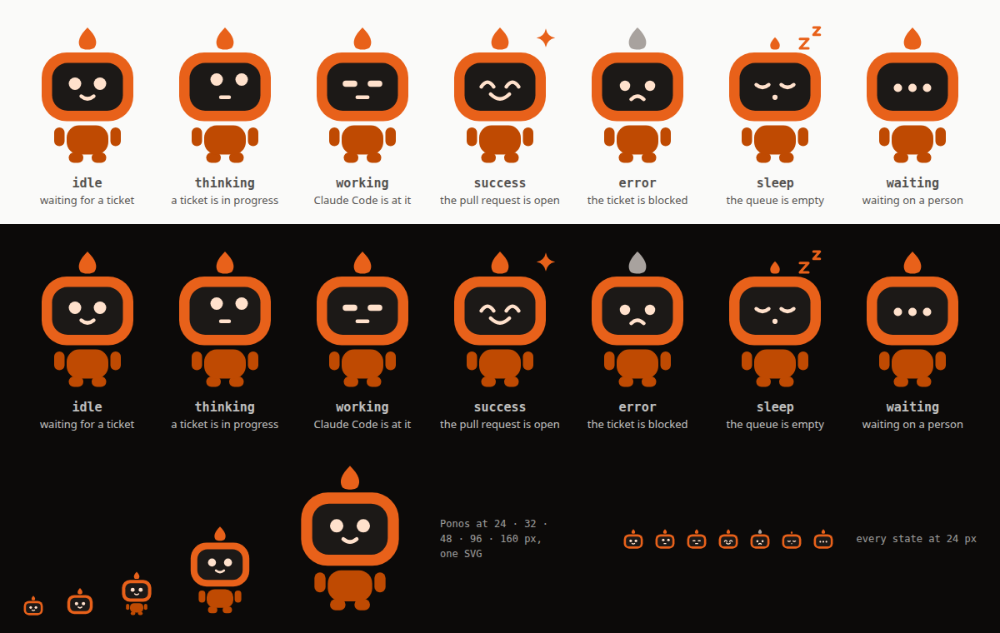

# Contributing to Ponos

This page is for working on Ponos itself: how it is put together, the console's code, the
tests, the mascot and the releases. Using it is in [the guide](guide/README.md).

- [Architecture](#architecture)
- [The console's own code](#the-consoles-own-code)
- [Ponos, the mascot](#ponos-the-mascot)
- [Tests](#tests)
- [Releases and versions](#releases-and-versions)

---

## Architecture


Everything inside the dotted frame runs on your machine and nowhere else. Three things are
outside it, and they are the only three the runner reaches: the Notion board it reads and
writes, GitHub when a branch becomes a pull request, and the channel you chose to be asked
questions on.

The picture is a still of an interactive diagram. `diagrams/architecture.html` is a single
self-contained file — open it in a browser and you can follow the five guided views (one
pass, a ticket with code, a ticket without, validated, where it reaches you), focus a
component, or click a node through to the file it is drawn from.

### Where each piece lives

A run is deliberately one object — one store, one reading of the workspace, one
cache of a page's comments — so what is split is the work, not the state. `base.py` holds
that state and says why the split is shaped the way it is; `runner.py` keeps the pass
itself and nothing else. The rest is one chapter per module:

| File | What it holds |
| --- | --- |
| `runner.py` | the pass: what a run is made of, and how places are kept filled |
| `base.py` | the state of a run, and what every chapter has under its hand |
| `board.py` | reading the board, and the tidyings a pass does first |
| `preparation.py` | locating the project, naming the nameless, telling its type, claiming the ticket |
| `execution.py` | the session, and the two ways a ticket comes back from one |
| `delivery.py` | the validated column: merging, or publishing what the ticket holds |
| `recurrence.py` | what a due schedule becomes — an ordinary ticket |
| `replies.py` | answering the comments that are waiting for an answer |
| `transitions.py` | the `On` column: the prompt a ticket runs at each change of its status |
| `reports.py` | what is written on a ticket, and what reaches your phone |
| `ticket.py` | `Ticket` and `Job`, the two nouns everything else passes around |

Around them sit the modules a run leans on rather than consists of: `store.py` and the
two boards behind it (`notion.py`, `files.py`, `sync.py`), `git.py`, `github_app.py` (the GitHub App and its tokens), `session.py`,
`voice.py`, `kinds.py` (the four types of ticket, and what counts as a doubt), `progress.py`, `conversation.py`, `schedules.py`, `credits.py`, `db.py` (the local SQLite
memory, `ponos.db`, and its numbered migrations), `journal.py` (every run and its steps, in it), `channels/` and `web/`.

### Regenerating it

The diagram is generated by [archify](https://github.com/tt-a1i/archify) from
`diagrams/ponos.architecture.json`, which is the file to edit — never the HTML.
The renderer is installed rather than vendored, and `.gitignore` keeps it out of the tree:

```bash
npx skills add tt-a1i/archify --skill archify --agent claude-code --copy   # archify 2.16
ARCHIFY=.claude/skills/archify/bin/archify.mjs

# The source declares a pinned revision, so the file links it draws are checked
# against a real checkout: bump meta.repository.revision when you regenerate.
node $ARCHIFY validate architecture diagrams/ponos.architecture.json \
  --quality showcase --repo-root .

node $ARCHIFY deliver architecture diagrams/ponos.architecture.json \
  diagrams/architecture.html --quality showcase --repo-root .

# Recapture the still this page shows, and keep the 2048x1320 light one
node $ARCHIFY visual-check diagrams/architecture.html
cp diagrams/architecture.visual-check.2048x1320.light.png diagrams/ponos.png
rm diagrams/architecture.visual-check.*
```

`deliver` refuses to write an artefact that fails its own layout and composition checks, so
a diagram that lands is a diagram that reads.

---

## The console's own code

The page is a **React** application — TypeScript, [Vite](https://vite.dev),
[shadcn/ui](https://ui.shadcn.com) on Tailwind v4, and react-resource-view's admin layout
over TanStack Router — and it lives in `frontend/`. What ships in
the package is the *build*: `src/ponos/web/static/` holds `index.html` and the
files under `assets/` — the console's script and stylesheet, and the chunks loaded only when a
page asks for them (the Markdown editor is the largest) — and those are committed. Every
name under `assets/` carries a hash of the file, so `serve` lets a browser keep them for a
year and gzips them on the way out; `index.html`, which names the current ones, is never
kept, and that is how an update reaches a browser that cached the last build.

That is the whole arrangement, and it is deliberate. `install.sh` clones this repository
onto a machine that has `python3` and `git`, and `ponos serve` is
[FastAPI](https://fastapi.tiangolo.com), served by [uvicorn](https://uvicorn.dev), in
the version's own `.venv`. **Nothing about the console asks the machine that runs it for Node.**
Node is a thing you need to *change* the console, not to use it.

The server side is four modules of `src/ponos/web/`. `server.py` is the door — the
token, the sign-in, the pages shown before it, `serve` — and stays standard library only,
because an installation still on v0.1.0 checks a new version by importing it with the
machine's `python3`. `app.py` is the application: one middleware, the guard, in front of
every route — the token or the session cookie, the `Host`, the `X-Ponos` header on a write,
the headers every answer carries — then the pages, the event stream (a `StreamingResponse`),
the first connection, the update and the MCP server. `routes.py` is the API the page reads
and writes, its bodies described by pydantic models; `answers.py` describes what it answers,
the models its routes name — every route that answers JSON names one, and a test holds it;
the three that answer bytes (a project's picture, a file of the board, a file of the
conversation) say none. The schema of all of it is served at
**`/openapi.json`**, behind the same token as the rest — the schema only: the pages that draw
one load their scripts from a CDN, which the console's policy refuses.

What the routes call is one object, `Api`, built the way a run is: one holder of the
state — the configuration reread when its file changes, the project index, the tickets
database ID, the tickets held between two readings, the moves queued for Notion — in
`web/base.py`, and the work split into chapters that add their methods to it. `web/api.py`
puts them together and says why:

| File | What it holds |
| --- | --- |
| `web/tickets.py` | the board and its tickets: reading, opening, creating, moving one |
| `web/projects.py` | the project index, a project's page and its pictures |
| `web/creation.py`, `web/removal.py` | creating a project, deleting one |
| `web/goals.py` | the goals, and how far their tickets have gone |
| `web/schedules.py` | the schedules, and launching one now |
| `web/configuration.py` | the settings, a project's own, the standing context |
| `web/overview.py` | the header's state and the statistics |
| `web/upkeep.py` | the health checks and their fixes, the disk and the tidy |
| `web/journals.py` | the history, the session logs, the runs of a ticket |
| `web/discussion.py` | a ticket's discussion, the decisions a card waits on, the chat's frame |
| `web/ideas.py` | finding ideas, scoring them, turning the kept ones into tickets |

```sh
curl -H "Authorization: Bearer $(ponos serve --print-token)" http://127.0.0.1:8787/openapi.json
```

```sh
cd frontend
npm install
npm run build      # writes ../src/ponos/web/static — commit what it writes
npm run dev        # hot reload, proxying /api to a console you started yourself
npm run dev:demo   # the same, on the made-up console of scripts/demo.py (below)
npm run lint       # tsc, in the strict configuration the build uses
npm run types      # src/lib/api-types.d.ts, from the schema — commit what it writes
npm run test:e2e   # the built console in your Chrome, on a board of files of its own
npm test           # node --test on the message bar's decisions — nothing to install
npm run test:components  # Vitest in jsdom: one component at a time, drawn and clicked
```

`npm run test:e2e` is Playwright, driving the Chrome already installed rather than a
browser of its own: `e2e/console.py` starts a real `ponos serve` on a throwaway
Markdown board, so the tests read the build that `npm run build` last wrote and nothing of
yours. They hold what neither Python suite can see — that a page taller than the screen
scrolls, by the wheel and by the keyboard, and still does once a dialog has come and gone.
Two servers are started, on free ports: one for the conversation with the workspace, whose
tests run one after another, and one for everything else, in parallel — a console holds a
single conversation, and a turn left running there would be in every other test's way. Set
`PONOS_E2E_PORT` to pin them (the chat takes the next port).

**One set of tokens for the console and the site.** The colours of both themes —
Hermez's, the design system in hermez-agency/brand-assets, on its stone greys and its
orange —, the faces (Bricolage Grotesque for headings, the system's own for the rest), the
radius, the `--tr-*` status colours and the chart
series live in `frontend/src/tokens.css`, which `index.css` imports. The landing page has
no build step, so it links `docs/tokens.css` — a copy that `npm run build` writes and that
`tests/run.py` checks is still byte for byte the source. Change a colour in
`frontend/src/tokens.css`, build, and commit both; `docs/index.html` names no colour of its
own, and recopies the shapes of the console's shadcn button, badge, card and tabs as plain
classes.

`npm test` runs `src/lib/*.test.ts` with Node's own test runner, which reads TypeScript as it
is (Node 22.18 or later): what it covers is what the message bar decides without a page —
which file it takes, what a pasted capture is called, when the arrow is off, what `>st`
completes to — kept in `src/lib/composer.ts`, which imports nothing for that reason.

`npm run test:components` is the layer between the two: Vitest, with Testing Library, draws
one component at a time in jsdom — the message bar, a ticket's page, the statistics band —
and checks what a reader would see: which file is refused and why, when the arrow lights
up, which tab a ticket opens on. The tests sit beside their component as `*.test.tsx`
(`.test.ts` stays Node's), mock what the component reads around it rather than start a
server, and ask for the English sentence of a `t("...")`, which is its key: the console is
drawn in English there whatever the machine's language, so a French translation that
changes moves no test.

`npm run dev` proxies `/api` to `http://127.0.0.1:8787` — set `PONOS_ORIGIN` for
another address. Open the real console once first (`ponos serve`, then its URL with
the token): the dev server borrows the cookie that URL sets, because the API refuses
anything else.

**Working on the console with nothing real behind it.** Three lines:

```sh
python3 scripts/demo.py            # a console on made-up data, port 8791, token "demo"
cd frontend && npm run dev:demo    # the page, hot reloaded, proxying /api to it
# open http://127.0.0.1:8791/?token=demo once (the cookie), then http://127.0.0.1:5173
```

`scripts/demo.py` is a real `ponos serve` on a throwaway Markdown board, under a temporary
`XDG_STATE_HOME` and `HOME`, with a stand-in `claude`, `gh` and `systemctl` first in the
`PATH` — no Notion, no network, nothing of yours read or written, and the directory removed
when you press Ctrl-C. The board is drawn to be looked at: eight projects, sixty-odd tickets in
every column, six weeks of sessions and costs, a stop of every family, recurrences, goals, ideas, a
bell and conversations. It is deterministic (one seed, dates counted back from the start),
and it shares only its harness (`scripts/workbench.py`) with `e2e/console.py`, whose data stay
the tests' own.

**Adding a component.** The project is a plain shadcn/ui project — `frontend/components.json`
is its configuration, and the components live in `frontend/src/components/ui/` where the CLI
puts them:

```sh
cd frontend
npx shadcn@latest add dialog dropdown-menu
```

The repository also declares the **shadcn MCP server** in `.mcp.json`, pointed at
`frontend/`, so an agent working in this repository can search the registry, read a
component's source and install it without leaving the session. Claude Code asks before it
starts a server a repository declares; `/mcp` is where you say yes, and where you check it
came up.

`components.json` carries an empty `"registries": {}` on purpose. The CLI merges its own
defaults over that key, so declaring `@shadcn` there by hand would *replace* its
style-aware URL and quietly break `add`; leaving the key present but empty is what makes
the MCP server announce the registry — without it, `get_project_registries` answers that
none is configured and `list_items_in_registries` refuses to look.

**The frame is react-resource-view's.** Every page of the console is a resource of one
[react-resource-view](https://github.com/hermez-agency/react-resource-view) *scope* —
`frontend/src/resources/scope.tsx` — and the frame around them is the package's
`AdminLayout`: the sidebar built from the scope's menu, the bar over the page, the page's
heading, and a navigation bar along the bottom edge on a phone. The console adds its mark,
the end of the bar (the stream's dot, the version, *Refresh*, the light) and an entry
component that puts a count beside a name; the conversation with the workspace stays
outside the frame, in the drawer the bubble opens.

The resources are `frontend/src/resources/*.tsx`. The board, the ticket page and the
*New ticket* form are one declaration — `tickets.tsx` — which the package renders as the
column layout, the table, the header the list opens on, the panel a new ticket is written
in and the addresses from it, with the forms drawn by
[react-data-form](https://github.com/hermez-agency/react-data-form). The projects, the
schedules and the settings are declared the same way. The one text every ticket is told is
not a resource at all: it is a block at the top of the projects' list, which it covers.

The package knows neither this router nor this API. The router is
[TanStack Router](https://tanstack.com/router), reached through the adapter the package
ships (`react-resource-view/tanstack`), in the package's `query` routing mode — the one
page the Python server serves is `/`, so the board is `/?view=console/tickets/list`, a
ticket `/?view=console/tickets/read/<id>`, and the same ticket in its window over the board
`/?view=console/tickets/list/tickets/read/<id>` — a reload opens it there again, Back closes
it. The *dialect* is twenty lines in
`frontend/src/lib/resource-view.ts`, because every read and write of a resource is its own
(the rows come off the stream, a ticket off `/api/tickets/<id>`, a drop is
`POST …/status`). The two transcripts — the workspace's and a ticket's — are shadcn's
`message` and `message-scroller`.

**Adding a sentence.** The console is written in English and the sentence *is* the key:
`t("Nothing is running.")` through
[react-mini-i18n](https://github.com/hermez-agency/react-mini-i18n), whose dictionary for
French is `frontend/src/lib/french.ts` — one line per sentence, and a key nobody has
translated is drawn as it was written rather than as a name nobody meant to read. The
machinery is `frontend/src/lib/i18n.ts`: which language, how it was guessed, and `useT()`,
which is `t` plus the redraw. The checks of the dashboard's health band (`health.py`) keep
their French apart, in `frontend/src/lib/health-french.ts`, which the band fetches when it is
drawn (`useFrench`): the first load of a French page is held to 500 kB, and most pages never
say one of those sentences. Two of the sentences the console shows are not written in it —
what a setting is called and the line of help under it come from `web/settings.py` — and they
are looked up by those very words, so a sentence reworded on the Python side has to be
reworded here too. A test says so by name.

Two rules the console keeps, and they predate React:

- **The stream is the truth.** A click posts and says nothing; what appears on the screen is
  what came back on `/api/events`. So two open tabs show the same thing, and an answer typed
  on a phone shows up on the laptop without either of them asking.
  The board travels on it whole once, when a tab connects, then as the tickets that
  changed (`changes`, numbered after the board they follow): a tab that finds a number
  missing asks for the whole board again, and a tab that reconnects is given it if it
  moved meanwhile.
- **Nothing is loaded from anywhere but this machine.** No CDN, no web font, no analytics —
  a console that reached off the machine would look broken on a train and would tell
  somebody else when you opened it. A test asserts it against the shipped files.

The page opens dark, because it sits beside a terminal and the thing it shows most of the
time is a log. The switch at the end of the bar changes that, and the choice is one line in the
browser's `localStorage` — read before the first paint, so the page never flashes white on
the way to dark.

---

<a id="mascot"></a>

## Ponos, the mascot



The product is called **Ponos**, and so is its face: a small robot named after the Greek god
of toil, whose mood follows a ticket. He is flat, and made of three shapes in two oranges —
a flame, a head whose screen is his face, a small body with its arms and feet — and every
state is said by the face alone. What a machine runs or addresses keeps the first
name — the command, the package, the repository, the paths and the element's tag all stay
`ponos`. He lives in one file,
[`docs/mascot/ponos-robot.js`](docs/mascot/ponos-robot.js) — a Web
Component in vanilla JavaScript, because the landing page is a single static file with no
build step and has to load it from a `<script>` tag:

```html
<script type="module" src="mascot/ponos-robot.js"></script>
<ponos-robot state="working" theme="dark" size="96"></ponos-robot>
```

| Attribute | Values |
|---|---|
| `state` | `idle` (default), `thinking`, `working`, `success`, `error`, `sleep`, `waiting` — any key of `STATES` |
| `theme` | `auto` (default, follows `prefers-color-scheme`), `light`, `dark` |
| `size` | a width in pixels; without it the robot takes the width of its container (the element is a square, the robot centred in it) |
| `still` | present, and the robot holds the pose of its state: no animation, no blinking — for a list of many |

| State | On the board | The face |
|---|---|---|
| `idle` | waiting for a ticket | round eyes, a small smile; breathes, the flame wavers, blinks at random |
| `thinking` | a ticket is in progress | eyes up to the right, a flat mouth; the flame wavers faster |
| `working` | Claude Code is at it | eyes narrowed to bars, a flat mouth; breathes quicker, the flame flickers |
| `success` | the pull request is open | eyes in arcs, a wide smile, an orange spark that twinkles |
| `error` | the ticket is blocked | small eyes, a pout, the flame grey and still — a fire gone out |
| `sleep` | the queue is empty | eyes closed, a small round mouth, the flame down to an ember, two *z*s drifting |
| `waiting` | a person has the next move — a review, the credits | three dots that tick |

The animations stay small — a breath, a blink, the flame in a draught. With
`prefers-reduced-motion`, every one of them stops and the robot holds the pose of its
state, which the face says on its own.

Under 40 pixels wide — a card, a toast, the bar — arms and feet are a smudge, so the robot
is only its head and its flame, zoomed to fill the same box, the strokes of the face
thicker: the state still reads. It is a container query on the element (and a media
query in the standalone SVG, or `standalone({ small: true })` to force it), so nothing has to
ask for it.

### The logo

The app's icon is not the robot: it is the **logo**, the robot's flame and screen in the
frame of the Hermez symbol — a white rounded square with an orange border, or, in its dark
version, a `#1c1917` square whose darker screen has a thin `#44403c` outline. It lives in
[`docs/mascot/ponos-logo.js`](docs/mascot/ponos-logo.js), and is written out as
`docs/mascot/logo.svg` (light), `logo-dark.svg` (dark) and `favicon.svg` (both, following
`prefers-color-scheme`). It is the favicon of the site and of the console, the icon an
installed app, a home screen, a dock and a notification show, and the Dokploy template's.

### In the console

The web console bundles the same file — `frontend/` imports it through the `@mascot` alias,
and its favicon is `docs/mascot/favicon.svg` — so the robot is never drawn twice. It is the
mark at the top of the menu — in the bar, on a phone — in the runner's mood right now
(asleep on an empty queue, thinking while a ticket is claimed, working while a session runs,
happy for a few seconds when a ticket comes back, put out when one has just been blocked or
the stream is lost, waiting when the credits are out), with its name beside it; one per card
and per row of the board, in the mood of its column; and the face of every empty list,
loading page, error and toast. Only a ticket in progress moves on the board — the others are
`still` — and every robot follows the console's own light or dark theme and is hidden from
screen readers, the words beside it carrying the state. The right end of the bar keeps words
only — the stream, the version, the sync with Notion — and no face.

### Layers

The drawing sits on a 120 × 140 grid, flat colours only, and its groups carry a `data-layer`:

```
frame                          everything — what the small head zooms
├── rig                        everything that breathes
│   ├── body                   arms, feet, torso
│   └── head
│       ├── flame
│       ├── the head and its screen
│       └── a face per state   [data-face="idle"]… — only the state's own is shown
└── fx                         what a state draws around the head: the spark, the z's
```

Each layer that turns or scales has its pivot in `PIVOTS`, in the grid's own units, so a
state scales the flame without knowing how big the robot is drawn.

### Colours

Colours are CSS variables, never literal fills in the drawing; `PALETTES` holds a
`light` and a `dark` set — the same values, since the orange head reads on both grounds.
A page can override any of them on the element itself:

| Variable | Used for | Value |
|---|---|---|
| `--robot-body` | the head | `#E8611A` |
| `--robot-body-shade` | torso, arms, feet | `#BF4A02` |
| `--robot-screen` | the screen | `#1c1917` |
| `--robot-eye` | eyes and mouth | `#FFE1CC` |
| `--robot-flame` | the flame, the spark, the *z*s | `#E8611A` |
| `--robot-ash` | `error`: the flame gone out | `#a8a29e` |

```css
ponos-robot.holiday { --robot-body: #4ade80; --robot-flame: #fde047; }
```

### Adding a state

A state is one entry in `STATES`, never a copy of the drawing: a label, what it means,
its `face` — SVG on the screen, inked with the classes `ink` (a fill) and `line` (a
stroke) — an optional `fx` around the head, and a map of layer → CSS declarations. The
plain declarations are the pose; `animation` names a keyframe from `KEYFRAMES` (without
its `robot-` prefix); `blink: true` lets the component close the eyes — the group of class
`eyes` — at random moments.

```js
// in STATES
surprised: {
  label: 'Surprised',
  means: 'a comment just arrived',
  blink: true,
  face: `<g class="eyes"><circle class="ink" cx="48" cy="58" r="7"/><circle class="ink" cx="72" cy="58" r="7"/></g>
    <circle class="ink" cx="60" cy="72" r="4"/>`,
  layers: { flame: { animation: 'boing .5s ease-out infinite' } },
},
// in KEYFRAMES
boing: '0%, 100% { transform: scaleY(1) } 40% { transform: scaleY(1.25) }',
```

### Regenerating the files

The standalone SVGs, the favicons, the Open Graph card, the sheet above and every icon are
written from the two modules — none of them is drawn by hand:

```bash
node scripts/mascot.mjs   # robot.svg, logo.svg, logo-dark.svg, favicon.svg, og.png, states.png in docs/mascot/;
                          # the app icons in frontend/public/pwa/; favicon.ico and apple-touch-icon.png in docs/;
                          # the desktop icons in src/ponos/icons/; docker/dokploy/ponos.svg
```

The PNGs are screenshots from headless Chrome (`$CHROME`, or `google-chrome` on the
`PATH`), only for the places that will not take an SVG; on the page, the robot is always
vector. Run it again after any change to either module, and commit what it writes.

---

## Tests

```sh
uv sync                        # httpx, pydantic, FastAPI, uvicorn and the tools below
uv run python tests/run.py     # one process per core; -j 1 runs the cases one after the other
uv run python tests/functional.py
```

No framework, and no dependency beyond the runner's own: a suite that needs more of an
install than the runner does is a suite that stops being run. `python3 tests/run.py` works
just as well with `requirements.txt` installed in that Python — which is what the CI does —
and runs itself again under the checkout's `.venv` when `python3` has no FastAPI, which the
console's cases start for real: `uv sync` once, and the command stays the same. The browser
tests' `e2e/console.py` does the same.
The requests the runner sends go through `ponos/http.py`, and the tests answer them with
an `httpx.MockTransport` (`_http_answering` in `tests/support.py`); the functional suite keeps
its own Notion, on a local port.

The pure part is written one file per module — `tests/test_update.py` for `update.py`,
`tests/test_web_server.py` for `web/server.py` — so that two tickets touching two modules
touch two files; what several of them share, the doubles of Notion, of a session or of a
board, is in `tests/support.py`. A case is a function registered with `@case`, and what it
needs set up and taken down around it — a state directory of its own (`state_home`), an
installation of this very runner (`installation`), a whole machine for the functional
suite (`machine`, with `@runner_settings(...)` for what it changes of `[runner]`) — it
names as a parameter: a fixture, written once in `support.py` or `functional.py` with
`@fixture`. `tests/run.py` imports every `tests/test_*.py` and runs what they registered,
opening each fixture a case names; both scripts share the cases among one process per
core, each of them with directories of its own, so that no case leans on another having
run first. A case that cannot run where it is — the version's commit, in a copy without
`.git` — raises `support.Skip("why")`: both runners report it skipped, with its reason.

The same cases also run under **pytest**, with the contributor's tools that
`pyproject.toml` declares and `uv.lock` pins — [uv](https://docs.astral.sh/uv/) installs
them into `.venv`:

```sh
uv sync                              # pytest, pytest-cov, pytest-xdist, ruff and mypy, at the locked versions
uv run pytest                        # both suites, one worker per core: -k to pick a case, -x to stop at the first failure
uv run pytest tests/test_update.py   # one module
uv run pytest -m "not functional"    # the pure part only
uv run pytest -n 0                   # in one process and in order, for a debugger
uv run pytest --cov=src/ponos        # with the coverage, the CI's floor being 80 %
uv run ruff check .                  # the lint the CI runs
uv run ruff format .                 # the format the CI checks
uv run mypy                          # the types: strict, but for the modules pyproject.toml still lists
```

The same checks can run before each commit rather than minutes after the push, with
[pre-commit](https://pre-commit.com), which `uv sync` brings along:

```sh
uv run pre-commit install                      # once per clone: the hook goes into .git/hooks
uv run --frozen pre-commit run --all-files     # every hook, on the whole tree
```

`.pre-commit-config.yaml` runs `ruff check --fix` and `ruff format` on the staged Python,
`uv lock --check` when `pyproject.toml` or `uv.lock` changes, rewrites `requirements.txt`
from the lockfile with the CI's own command — a diff fails the commit, and the file left
behind is the one to stage — and refuses a commit that changes `src/ponos/web/static/`
without changing anything in `frontend/`, since that directory is what `npm run build`
writes. Every hook runs the tools `uv.lock` pins, so nothing is fetched and nothing
drifts from the CI. Run it by hand with `--frozen`: a plain `uv run` updates `uv.lock`
before the hook can see that it lagged. It is a contributor's tool and nothing more: no
installation reads the file. `SKIP=static-built-from-frontend git commit` lets through a
rebuild that has no source change, a new Node for instance.

`tests/conftest.py` hands pytest the very cases the two scripts run, one test each under
its own name, and the same fixtures: nothing is written twice. The coverage counts the
Python a test starts in a subprocess — `python3 -m ponos`, an update trying its new
code — as well (`[tool.coverage.run] patch = ["subprocess"]`). Ruff checks pyflakes, the pycodestyle errors,
warnings, bugbear, the order of imports, the syntax of Python 3.11 and some
simplifications, with no exception list: a deviation is fixed, or justified by a `# noqa`
on its line. `ruff format` is enforced too; the commit that formatted the whole repository
is in `.git-blame-ignore-revs`, which GitHub reads and `git config blame.ignoreRevsFile
.git-blame-ignore-revs` makes local `git blame` read. The technical audit of October 2026, with what comes next, is
[notes/audit-technique-2026-10.md](notes/audit-technique-2026-10.md).

The first covers the pure part — identifier collisions, status mapping, the
markdown-to-Notion conversion, deep links, property encoding, which message answers which
ticket, who a comment is addressed to — which is to say what has already gone wrong
once, or would go wrong silently. It touches neither Notion, nor git, nor the network.

The second covers the road itself, which is the half that breaks quietly: ready ticket →
worktree → session → branch → pull request, and the status written back onto the ticket.
Four scenarios — a code ticket that comes back as a pull request, a writing ticket
answered in its own page without a single git command, a session that fails without
leaving an orphan worktree, and a board with two projects where the ticket has to run in
the repository its `Project` relation names. Two more follow a ticket with no `Type`: one
classified *Publication*, prepared into *In review* without a worktree and published only
on the pass after it was moved to *Validated*; one the classification hesitated over,
blocked with the question while a ticket typed by hand runs beside it. Nothing is mocked: a **Notion of its own**
answers on a loopback port and keeps a state the assertions read back, a repository and a
bare remote stand in for GitHub, and a `claude` and a `gh` at the head of `PATH` do what
the real ones do minus the thinking and the network. Nothing leaves the machine, nothing
is written outside a temporary directory — `XDG_STATE_HOME` moves with the test — and the
four of them take a handful of seconds. The one thing the runner cannot guess is where
Notion lives, so that is the one seam in the code: `PONOS_NOTION_API`, read at
each request and unset in every installation.

How fast the console goes from page to page is a browser's question, so it is
not in either suite:

```sh
node scripts/measure-console.mjs --runs 3 --throttle 4
```

writes a throwaway Markdown board of 350 tickets, 340 of them Done, serves it from this
checkout and drives headless Chrome (`$CHROME`, or `google-chrome`) over the board, the
projects and the schedules — how long each page takes to be drawn, and the longest the
browser is held on the way. `--throttle` slows the CPU down by that factor.

The film the landing page shows under its hero is the console too, and it is
regenerated the same way:

```sh
node scripts/film-console.mjs
```

writes the demonstration board of the screenshots, serves it from this checkout and films
headless Chrome through one ticket — *New ticket*, *In progress* with its live line,
*In review* with its cost, *validate* — in light and in dark, into
`docs/media/console-loop-{light,dark}.mp4` and their posters (ffmpeg makes the videos). No
Claude Code session runs: a stand-in holds the run lock, writes the session log and moves
the ticket with the runner's own pieces, so the console shows what it shows of a real run.
The script also writes, into `docs/index.html`, the second at which each of the four
gestures begins, for the legend under the film to follow it.

`.github/workflows/ci.yml` runs both suites on every pull request and on every push to
`main`, on Python 3.11 — the oldest the runner promises — and 3.13, after installing
`requirements.txt` as an installation does — the runner opens its
own PRs, and none of them was checked before merge until this ran. A second job builds and
lints `frontend/` the same way, but only when `frontend/**` or `src/ponos/web/**`
changed — the browser tests open the console's server as much as its page — and then fails if
`src/ponos/web/static` is not exactly what that build produces: the console is
served from the committed build, so a change to the console without its build is a change
nobody receives. The workflow only ever reads the repository (`permissions: contents:
read`). A third job runs `uv sync --locked`, ruff,
checks that `requirements.txt` is the export of `uv.lock`, and runs both suites under
pytest with their coverage, which fails under 80 %. `.github/workflows/release.yml` is separate: it re-runs both suites once more, at
the tagged commit, when a version is published. `.github/workflows/links.yml`, on
Mondays and by hand, asks the network whether every external link of the README, this
file, the guide and the site still answers (`python3 scripts/check-links.py` does the same
locally); it gates no pull request, since a site down for an hour is no reason to refuse a
commit.

---

## Releases and versions

`ponos` typed alone presents the product and the version it is running — as do
`ponos --version` and the console, at the foot of its menu. Off a release tag the
number is followed by the commit (`0.2.0+2489ec6`): every commit between two releases
runs under the same number. The number is a real
one, and [`CHANGELOG.md`](CHANGELOG.md) says what each one changed, in the words a user
would use rather than in commit subjects. The numbers are [semantic](https://semver.org/),
read from an installed runner's point of view: **major** when your installation needs a
hand to keep working, **minor** when the runner gained something, **patch** when it
stopped getting something wrong.

**A release is what an installation updates to.** By default the runner follows the
newest `vX.Y.Z` tag and nothing pushed in between, so tagging a version *is* shipping it to
every installation within the hour — and merging into `main` is not. An installation that
would rather have every commit as it is merged says `runner.update_channel = "main"`. Tags
are also for people: the changelog you read before an update lands, and

```sh
TR_REF=v0.1.0 sh install.sh
```

for an installation that would rather sit still. The runner says so itself — a fixed
revision reports *"pinned to a fixed revision — nothing to follow"* and stops updating,
because a version you chose is a choice, not a state to be corrected.

### Cutting one

The whole thing is four files and one rule: the version lives in `__version__`, the notes
live under `## [Unreleased]`, and nothing writes either of them by hand.

```sh
python3 scripts/release.py bump minor    # promotes the notes and writes the version
python3 tests/run.py
python3 scripts/release.py check         # everything that must be true before a tag
git commit -am "release: 0.2.0"
git tag -a v0.2.0 -m "ponos 0.2.0" && git push origin v0.2.0
```

The tag push is the whole request. `.github/workflows/release.yml` re-runs both suites at
that commit and creates the GitHub release with the `## [0.2.0]` section as its body — so
the release notes cannot say something the repository does not.

And because this is a project whose whole point is that Claude does the work: the
procedure is written down where Claude reads it, in
[`.claude/skills/release/SKILL.md`](.claude/skills/release/SKILL.md), and `/release minor`
runs it. It stops before the tag and asks — publishing is visible to everyone who installs
the runner, and that stays a decision somebody makes on purpose.
