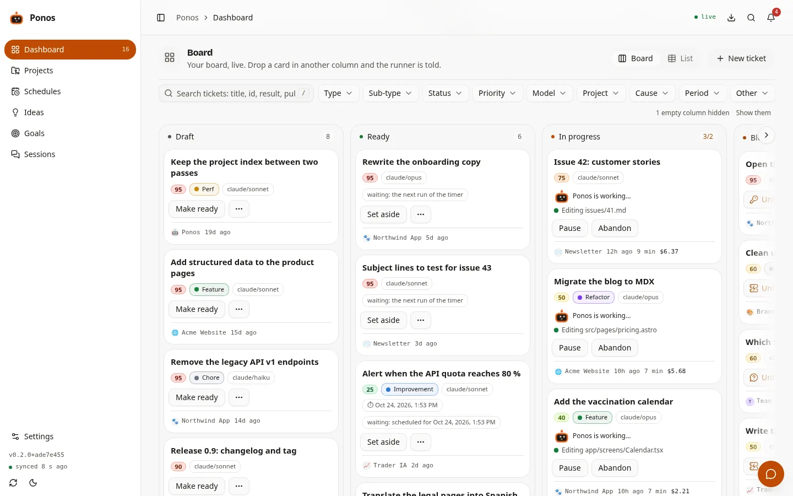
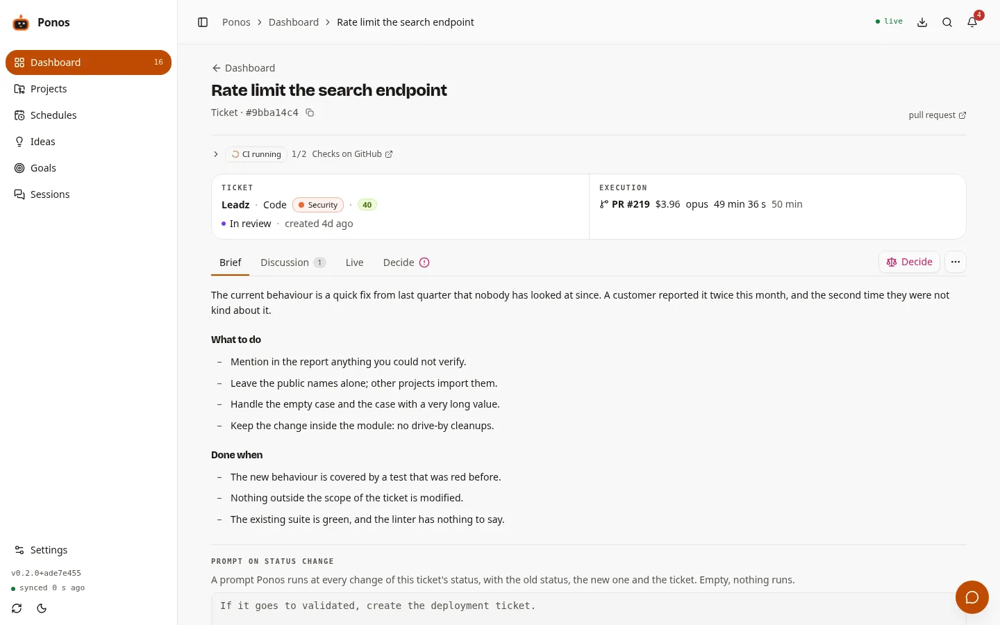

<p align="center">
  <a href="https://the-ponos.app/"></a>
</p>

<h1 align="center">Ponos</h1>

<p align="center">
  <strong>Write the ticket. It comes back done.</strong><br>
  <em>Écris le ticket. Il revient fait.</em>
</p>

<p align="center">
  <a href="https://github.com/hermez-agency/ponos/actions/workflows/ci.yml"></a>
  <a href="LICENSE"></a>
  <a href="CHANGELOG.md"></a>
  <a href="guide/installation.md#installation"></a>
  <a href="pyproject.toml"></a>
</p>

<p align="center">
  <a href="https://the-ponos.app/"><b>📖 The documentation, online</b></a> ·
  <a href="https://the-ponos.app/#video"><b>▶ The one-minute video</b></a> ·
  <a href="#install-it"><b>Install</b></a> ·
  <a href="guide/server.md#docker"><b>Docker</b></a> ·
  <a href="CHANGELOG.md"><b>CHANGELOG</b></a>
</p>

<p align="center">
  <a href="guide/server.md#install-with-dokploy"><picture><source media="(prefers-color-scheme: dark)" srcset="docs/media/dokploy/deploy-on-dokploy-dark.svg"></picture></a>
</p>

**A harness around [Claude Code](https://claude.com/claude-code) that runs your tasks on
your machine — code, writing, actions, posts.**

Write the ticket on **Ponos**'s own board — the console, or a folder of Markdown files. He
brings back a pull request, a text, an action carried out or a post ready to go. You answer
in a word, even from your phone, and nothing ships until you say yes. Notion, GitHub,
Telegram, Slack and OpenRouter plug in when you want them; none of them is required.

[](https://the-ponos.app/#video)

<sub>▶ **[Ponos in a minute](https://the-ponos.app/#video)** — one ticket, from *Ready* to *Done*. The video plays on the site, sound on.</sub>

The name is a robot's, after the Greek god of toil: he does the tedious part of a ticket in
your place, and you keep the decisions. The repository, the `ponos` command, the Python
package and every path on your machine carry his name too. An installation from before the
rename moves over on its own — see the [CHANGELOG](CHANGELOG.md) for what it does.

## The loop, in four gestures

Two of them are yours, and each takes a few seconds. The two in between are Ponos's.

1. **You write the ticket** — what you would tell a colleague, on your board — then you
   move it to *Ready*.
2. **Ponos does it** while you do something else: a pull request on its own branch, a text
   written into the ticket, an action carried out.
3. **You read, and answer in a word.** A question or a result reaches you — in the
   console, or on your phone. *oui* is a whole answer.
4. **He delivers.** Move it to *Validated*: the pull request is merged, the post is
   published — and only then is it *Done*.

<p align="center">
  <a href="https://the-ponos.app/#loop">
    <picture>
      <source media="(prefers-color-scheme: dark)" srcset="docs/media/console-loop-dark-poster.webp">
      
    </picture>
  </a>
  <br><sub>The console, filmed doing the four gestures — <a href="https://the-ponos.app/#loop">the film plays on the site</a>.</sub>
</p>

## Three things it does that a to-do list does not

- **It asks first — a doubt stops it.** A ticket nobody typed is classified before it
  runs, and a hesitation sends it back to you with the question. An action stops at its
  first doubt — a wrong account, a value the ticket does not give — rather than act on a
  guess. See [The type of a ticket](guide/board.md#the-type-of-a-ticket).
- **You keep the hand — nothing goes out without you.** No pull request is merged and
  nothing is published until you move the ticket to *Validated*. And it all runs on your
  machine, each ticket in a disposable worktree — your own checkout is never touched. See
  [What protects your code](guide/safety.md#what-protects-your-code).
- **It comes to you — “oui” is enough.** When a ticket needs a decision, the question
  reaches you on **Telegram or Slack**, and your reply lands on the ticket. See
  [Being told, and answering with one word](guide/channels.md#being-told-and-answering-with-one-word).

**Not only code — four kinds of task.** The ticket's type decides the road: pick it, or let
a small model read the ticket and choose.

| Type | A ticket | What comes back |
| --- | --- | --- |
| **Code** | *Console: limit the Done column* | A pull request, on its own branch and a disposable worktree; the tests run. Merged when you validate. |
| **Writing** | *Draft the October newsletter* | A text, written into the ticket, ready to copy. No repository needed. |
| **External action** | *Add the DNS records for the new domain* | Done in the browser or a service's settings, with every change logged. It stops at its first doubt. |
| **Publication** | *Post the 1.2 release on LinkedIn* | Prepared and shown to you first. Published once you say yes. |

Tickets also [come back on their own](guide/tickets.md#what-comes-back-on-its-own) on a schedule, and the
console's chat is a Claude Code session in your workspace.

## A board of its own

Ponos needs nobody else's board. The [console](guide/console.md#the-web-console), on `127.0.0.1`, is where
you write a ticket, drag it to *Ready* and watch its session live. Under it, the board is
[a folder of Markdown files](guide/board.md#without-notion-the-board-as-markdown-files): `grep`, your
editor and `git` read it too.

<p align="center">
  <picture>
    <source media="(prefers-color-scheme: dark)" srcset="docs/console/board-dark.webp">
    
  </picture>
  <picture>
    <source media="(prefers-color-scheme: dark)" srcset="docs/console/ticket-dark.webp">
    
  </picture>
</p>

Everything runs on your machine; the board, GitHub and your channel are the only things it
reaches — see [Architecture](CONTRIBUTING.md#architecture).

<p align="center">
  <a href="CONTRIBUTING.md#architecture"></a>
</p>

## Plugs in where you already work. If you want.

Ponos needs Claude Code and nothing else. Each of these is one more token in the settings,
and none of them is a requirement.

| | Optional | |
| --- | --- | --- |
| <a href="guide/board.md#the-notion-side"><picture><source media="(prefers-color-scheme: dark)" srcset="docs/media/notion/made-for-notion-black.svg"></picture></a> | **Your board in Notion.** | Tickets, projects and schedules become Notion databases, and every report is written back on the ticket's page. [The Notion side](guide/board.md#the-notion-side) |
| **GitHub** | **Pull requests.** | A code ticket comes back as one, through a GitHub App, an access token or `gh`, and is merged on your yes. Writing, actions and posts need none of it. [Several GitHub accounts](guide/configuration.md#several-github-accounts) |
| **Telegram · Slack** | **Your phone.** | A question or a result reaches you there, and your answer — *oui* will do — lands on the ticket. [Telegram and Slack](guide/channels.md#being-told-and-answering-with-one-word) |
| **OpenRouter** | **Every other model.** | One key: a GPT writes the copy, a model transcribes a voice note — or the sessions themselves run on the model you name. [Every other model](guide/configuration.md#every-other-model) |

## Install it

One command. It checks what your machine has — Python, git, Claude Code and its sign-in, room
on the disk —, names whatever is missing with the command that installs it, starts Ponos and
**opens its console in your browser**. Beyond Claude Code, nothing to sign up for.

```sh
curl -LsSf https://raw.githubusercontent.com/hermez-agency/ponos/main/install.sh | sh
```

Everything after that happens in the console, on `http://127.0.0.1:8787` — never on the
Internet: a [first connection](guide/console.md#the-first-connection) in steps, each one checked against the
real thing before the next. The language; the password that opens the console; who answers
the sessions; Notion — paste the integration's token, add it to one page, and the board is
built under that page, found on its own as soon as it is shared; GitHub in one click; a first
project; and a demonstration ticket, played there and then, which is the proof that every
step holds. No Notion? The board can be [a folder of Markdown files](guide/board.md#without-notion-the-board-as-markdown-files).

It needs Linux or macOS, `python3` ≥ 3.11 — what it imports, httpx and pydantic for the
runner and FastAPI and uvicorn for the console, goes into an environment of its own, made by the installer —,
`git` and [Claude Code](https://claude.com/claude-code), which the installer offers to
install when it is missing. `gh` is optional: the console connects GitHub itself. What the
installer arms, how Ponos updates itself and every variable it reads are in
[Installation](guide/installation.md#installation); where it stops, and what to do, in
[Troubleshooting](guide/troubleshooting.md#while-installing).

Or in a container, on your machine or behind a domain: `docker compose up -d`, then the
console's first connection — see [Docker](guide/server.md#docker). On Dokploy, a template does it in one
click: [Install with Dokploy](guide/server.md#install-with-dokploy).

---

## How a ticket travels

```
Notion                    Ponos                               what you get
──────                    ─────────────                       ────────────

Ready         ──────▶     claims it, writes the session link
                          │
In progress   ◀───────────┤
                          │
                          ├─ has a repository ──▶  worktree, branch, commits
                          │                        push + gh pr create      ──▶  a pull request
                          │
                          └─ has none ──────────▶  scratch dir, ANSWER.md
                                                   published as Notion blocks ──▶  the page itself
In review     ◀───────────  a pull request is waiting for you
Validated     ──────▶     merges that pull request — or publishes what the
                          ticket holds: the post, the mail, the announcement
Done          ◀───────────  once it is in
```

Which of the two you get is decided by the ticket's **Type** when it has one — *Code*,
*Writing*, *External action*, *Publication* — and otherwise by the project: a project that
names a repository produces code, a project that names none — or a ticket with no project
at all — produces a document. A ticket that reaches *Ready* with no type is classified
first, and a doubt stops it before anything runs. See [The type of a ticket](guide/board.md#the-type-of-a-ticket).

---

## The documentation

The guide, one page per subject — [its contents](guide/README.md):

| Page | What it covers |
| --- | --- |
| [Installation](guide/installation.md) | what the installer arms, updating, the install variables, uninstalling |
| [Configuration](guide/configuration.md) | Notion, `config.toml`, who answers the sessions, OpenRouter, GitHub, the vault |
| [The board](guide/board.md) | the board as Markdown files, the Notion databases, the type, sub-type and model of a ticket |
| [A ticket's life](guide/tickets.md) | the comments, the statuses, ten tickets on one repository, *Validated*, the tickets that come back |
| [Telegram and Slack](guide/channels.md) | being told, and answering with one word |
| [The web console](guide/console.md) | the console, its first connection, signing in, connecting Ponos to Claude |
| [Every command](guide/usage.md) | the `ponos` command, its exit codes, and what `clean` removes |
| [What protects your code](guide/safety.md) | the worktrees, the permissions, what a session cannot touch |
| [When the credits run out](guide/credits.md) | waiting for the window, what a session may do alone, spending limits |
| [On a server](guide/server.md) | a server, Docker, Dokploy |
| [Troubleshooting](guide/troubleshooting.md) | while installing, and once it runs: symptoms, journals, `ponos.db` |

Working on Ponos itself — the architecture, the console's code, the tests, the mascot,
releases — is in [CONTRIBUTING.md](CONTRIBUTING.md).

---

## Author

Ponos is a Hermez product.

---

## Licence

MIT.
