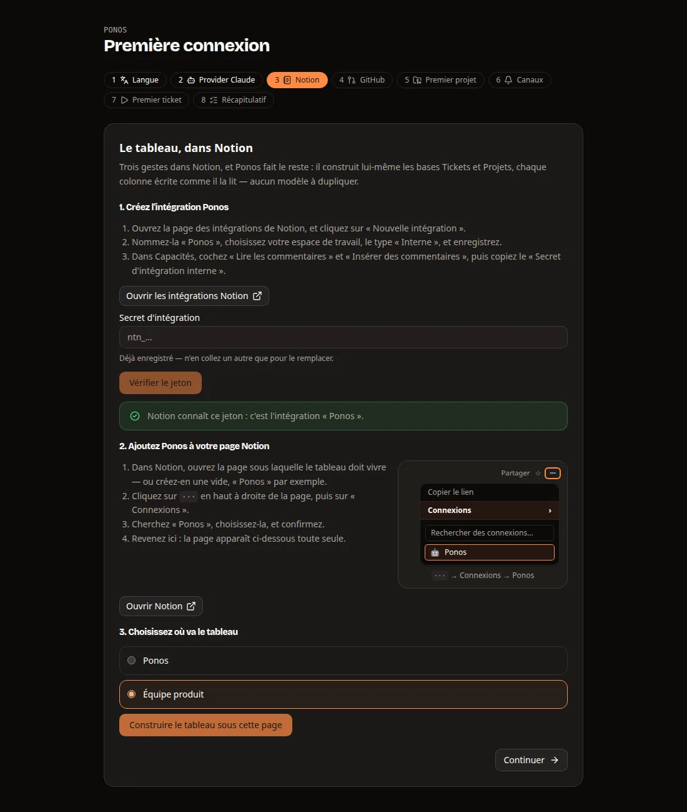
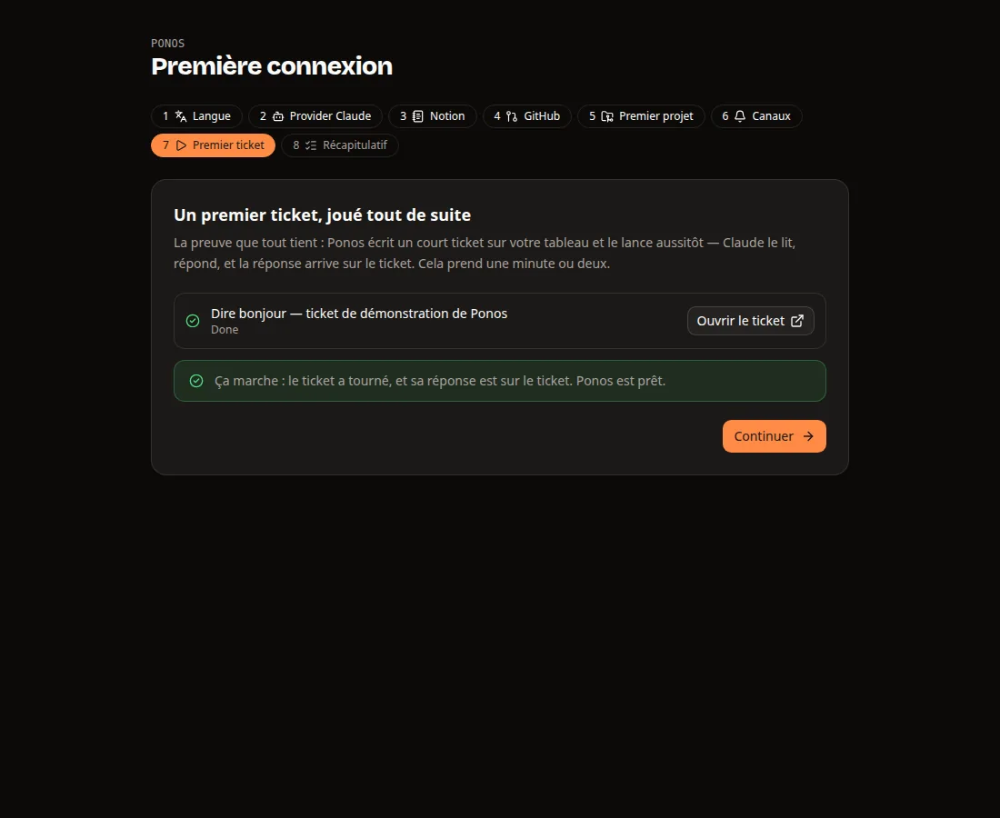

# The console

[The guide](README.md) · [Ponos](../README.md)

The web console, and Ponos as a connector in Claude.

## The web console

A folder of files, or Notion, is where tickets are kept; neither is a place to *steer*
from. So there is a window on the same workspace, served from your own machine — and it is running
already: the installer starts it and prints the address, token included. On an installation
nobody has set up yet there is no token to paste either — the address alone opens
[the first connection](#the-first-connection), which is where the rest of this page's
configuration gets filled in.

```sh
ponos serve --print-token   # the token, if you lost the URL
```

Open `http://127.0.0.1:8787` and you get one page, four things:

```
┌───────────────┬──────────────────────────────┬─────────────────────────────┐
│ Ponos         │        ● live  v0.9.2  ⟳  ☀  │  you                        │
│               │ + New ticket   board · table │  Where is the SQLite ticket │
│ ▸ Dashboard 4 │  Ready     1   In progress 1 │                             │
│   Projects    │  ┌──────────┐  ┌──────────┐  │  workspace                  │
│   Schedules   │  │ Retirer  │  │ Migrer   │  │  Six minutes in, on Trader  │
│   Context     │  │ le       │  │ vers     │  │  IA. It has rewritten       │
│   Settings    │  │ bandeau  │  │ SQLite   │  │  src/storage.py and is on   │
│               │  │ High     │  │ pytest   │  │  pytest. Nothing committed. │
│               │  └──────────┘  └──────────┘  │                             │
│               │                              │  > status                   │
│               │                 ───▶      (●)│  timer on · 30 min          │
└───────────────┴──────────────────────────────┴─────────────────────────────┘
     the menu           the board, live            the drawer the bubble opens
```

**The menu** down the left is where the pages live: a name each, and a count beside it
where something is waiting there — how many tickets are on the board. On a phone the menu runs
along the bottom edge instead: the board, the projects and the schedules, and **More**, which
opens the settings from the bottom of the screen — the bar
fits a 360px screen and never scrolls sideways. The bubble stands on that bar, and every page
ends far enough above it that nothing is left under it. The frame is react-resource-view's admin layout (see
[The console's own code](../CONTRIBUTING.md#the-consoles-own-code)), and the end of its bar holds the things
about the console itself: whether the event stream is up — a stream the server refuses
because the session expired sends the page back to the sign-in rather than saying
*reconnecting…* forever — the version this one runs — in amber, with what to type, on the
day a newer one is waiting — when the board last agreed with Notion, a green dot that
turns amber when something is out of step (the tooltip says what), and the two buttons
that **resynchronise** — the whole board read again, the refused moves sent again — and
change the light. On a phone, where the bar has room for none of those words, the stream,
the last read and the version are one pill — a dot and *live* — that a tap opens on all
three. Every page has an address — `/?view=console/tickets/list`,
`/?view=console/tickets/read/<id>` — so a reload, a bookmark or a link pasted into a chat
lands where you were. The page of *running* sessions the console used to have is gone, and its old
address leads to the board: a ticket's session is followed on its ticket.

**Sessions** is the entry for the other kind — your conversations with the workspace, the ones
the bubble opens. Each is kept in `ponos.db`, so they survive a restart: the page lists them
from the latest to the oldest, with a title made of the first message (renamable, as is the
project it is about), the date of the last message and the model it ran on. A row reopens the
conversation with its whole transcript and carries on where it stopped — it is the same Claude
Code session, resumed. The search looks in the titles and, failing that, in what was said;
*New session* starts another; deleting asks for a box to be ticked, as deleting a project does,
and takes the transcript and the files sent in it. The model is chosen from the conversation
itself, in the bar over it, and kept per session: the Claude models (`opus`, `sonnet`, `haiku`,
`fable`) and, once `OPENROUTER_API_KEY` is set, any model OpenRouter lists — searched by name, the
ones you used last first. A session on an OpenRouter model talks to OpenRouter whatever
`claude.provider` says; without a key the picker offers Claude's models and leads to the
setting. `web.chat_model` is the model a new session starts on.

**The dashboard** opens on the period's [statistics](#statistics-on-the-dashboard), then
the board. **The board** is the Notion board, read from Notion and written back to it, drawn as
the columns the board has — *Ready*, *In progress*, *In review*, *Validated* where the
board offers it, *Blocked*, *Failed*, *Done* — under the board's own names. Nothing here
is a second database: **drag a card into a column and the ticket moves**, and the ticket
you write behind *New ticket* is a page in the same database, with its brief as real
Notion blocks — and, where the board has those columns, its *Priority*, *Type* and *Model*
(an empty type is deduced by the runner, as for a ticket written in Notion). *Ready to
run* is ticked by default, and the form says what that means: a session, at the next
pass. **Ctrl+Enter** (⌘+Enter) creates the ticket from any of its fields. What the console adds is the part Notion cannot do — the running session's
steps, live, read straight from the session log on disk rather than from the `Progress`
column. A card in progress has a pulsing dot, how many steps its session has taken, and
what it is on in one line — what the agent last said, or else the last tool it ran. Over
the columns, one strip carries the runner's figures: the sessions writing, the timer
between two passes, the tickets handled and what they cost. A card in review carries a **validate** button, where the board has that column:
confirm it and the next pass merges its pull request, or publishes what it holds; *run
again* asks the same way, since it starts a session that is paid for. A move is queued by
the console rather than made while the browser waits: the card lands in its new column
saying *waiting to be sent to Notion*, the console reads the page first — and **does not
overwrite a status somebody changed in Notion since the card showed it**, saying so on the
card instead — writes it, reads it back to confirm, and tries again with a growing wait
when Notion is slow or answers 429. A move Notion refuses for good says *not sent to
Notion* on the card, and stays said until *resynchronise* or another move. The queue is
kept on disk (`~/.local/state/ponos/web/outbox.json`), so a console restarted
mid-way still sends it. A gesture that sends a card off the screen —
*hold*, into your *Blocked* column — says where it went. A ticket with no status, or one
your board has not named, is not hidden: it sits in the first column, *Draft* (*Brouillon*
in French), with the drafts. Seven columns do not fit a laptop, so the board scrolls sideways, and each
edge with more beyond it shows a fade and an arrow. The *table* tab shows the same tickets
as rows, one column per property.

**A search bar sits over the columns**, the same on a project's *Tickets* tab. Its field
looks for every word typed, in any order, case and accents set aside, in the title, the
runner's line on the card (the RESULT a run ended with), the pull request's address — so
`#201` finds it — the project and the runner; a short id finds its ticket from four
characters, and a pasted branch, worktree or Notion address finds the one ticket it names.
Beside it, filters that combine with the words and with each other: *Type*, *Sub-type*, *Status*,
*Priority*, *Model*, *Project* (not on a project's page), *Period* (created or changed
today, in the last 7 or 30 days) and *Other* — with a pull request, waiting for credits,
a move not yet synchronised, a cost above $1, $5 or $20. Each list offers only what the
board's tickets carry, with how many carry it. A search hides cards, not columns: each
column says how many it kept, `3 / 12`, the words found are marked on the cards, and a
search that keeps nothing says so with a button to clear it. It is all in the address
(`&q=…&type=code,writing&status=ready`), so a filtered board is a link to send and survives
a reload and the switch to the table. **/** goes to the field, **Escape** empties it. On a
narrow screen the filters fold behind one *Filters* button. It searches what the board
already holds, so it is instant; the brief, which the board does not carry, is not searched.

**A card is a way in.** Click one — or a ticket's title in the table — and the ticket opens
in a window over the board, the whole screen on a phone; its header has its short id, its
title, a button to its full page and a cross (Escape closes it too), and the board is
where you left it underneath. The full page has an address of its own, the one a shared
link, the palette and a notification open. Either way it is the brief you wrote, the
report a run appended, the notes in between — the page under the card, as the runner
reads it — with its links out (Notion, the pull request, the session) and the gestures it
offers where it stands. Under the column it stands in, three tabs: **Brief** — the facts
(project, type, priority, model, cost, pull request) and the page you wrote —,
**Discussion** and **Live**. A ticket in progress opens on *Live*, one waiting on you on
*Discussion*, any other on *Brief*; the tab you pick goes into the address (`&tab=live`),
so a reload or a shared link comes back to it. *Live* wears a green dot while a session
runs, *Discussion* a question mark while a question waits for you. *Live* is the session's
journal in its broad lines, growing as it is written and following its end until you
scroll up to read something: what the agent says is one line each, drawn as prose, and the
tool calls that followed it — up to the next thing it said — are folded under it, the
toggle saying how many steps, how long, and how many failed, marked in red. The steps
before it said anything are a group of their own, *Getting ready*. The line being written
says what the agent is on, in a few words, without unfolding anything; *Unfold
everything* opens them all at once, and a line you opened stays open as new steps arrive.
Unfolded, each tool call is one line — the tool and the start of its command, the
worktree's path written `./` — that a click unfolds in turn. The steps come from the local run
journal (`ponos.db`, below), not from the page: the tab opens on the end of the newest run,
*Earlier steps* reads further back two hundred at a time, and while the run goes on each
step the stream announces is read from the journal as it lands. Every run the ticket has
had is kept there — a select over the steps picks an earlier one, by its date, how it
ended and what it cost — and the line above them says how it ended, with the pull request
or the reason; a finished run reads in the same broad lines. A ticket whose runs all predate the journal is read back from its last log,
as before. The **discussion** tab is the ticket's own terminal, counted on the
tab itself: everything said on it, oldest first — the runner's reports, your answers, the
answers you gave from Telegram — and the console's own message bar to say the next thing
(Enter sends, the microphone dictates; no files, since a comment carries text). A ticket
**waiting on you** — in *Blocked*, or with a question a run asked and nobody has answered
yet — opens on that tab, and its card on the board says *waiting for you*, or the cause it
stopped on when the runner knows it (*Question for you*, *Credentials missing*…). What you type is a
*comment on the ticket*, written into the thread the runner last spoke in, which is the
gesture the runner already knows: an answer under the question a run asked puts the ticket
back in the queue, and one that names it — `@claude`, or whatever `notion.mention` says —
asks it for words instead. Nothing is kept on the side; the same sentence typed into Notion
does the same thing.

**The bell.** The icon in the header counts the notifications you have not read, and opens a
dropdown over the board: the latest first, with an icon for what happened, the ticket's title, its
project and how long ago. A click opens the ticket's card and marks that one read; *Mark all as
read* empties the badge; Tab and Enter reach everything, Escape closes it, and on a phone it spans
the width of the screen. It rings for a session that stopped on a question, a pull request ready to
read, a pull request whose checks fail (`merge.checks-failed`), a failed session and any other
blocked ticket — and for nothing routine. The run writes them into `ponos.db` (`notifications`;
one unread per ticket and kind), the console reads them off the same stream as the board, and a
notification read more than thirty days ago is purged.

**Unblock and Decide.** A *Blocked* card carries one button, **Unblock** — no *answer* or
*make ready* beside it — and a card *In review* a **Decide** one. Unblock opens the ticket's
window on its *Discussion*, marked with a question mark and scrolled to the end; Decide on a
tab of that name, beside *Brief*, *Discussion* and *Live*, there only while the ticket is in
review. The same button on the ticket itself switches to it, and on its page the tab is in the
address (`&tab=discussion`, `&tab=decide` — an old `&tab=unblock` link opens the discussion).
In the discussion, the report the session stopped on is drawn once, as Ponos speaking: what is
done, why it stops, and the question in bold. Under it, quick replies, each a click that
answers and runs the ticket again: *Yes* and *No* for a yes-no question, one per option —
in full, never cut — for a choice, *Yes, close it* when the session proposes to close the
ticket (a duplicate, nothing to do), which files it as *Done* with a comment, and always *Run
it again as it is*. One field under them takes an answer or an instruction alike (Enter or
Ctrl+Enter sends), with the model to run it on next beside it on a board with a *Model*
column; *Run it again as it is*, *Abandon* — confirmed first — and *See the session* are behind
the ⋯ of the discussion. Once something is sent, Ponos is shown at work under it — the robot
of the *Live* tab, *Ponos is working…* — until it says something back, or the session fails,
which is said in its place; the quick replies wait meanwhile. The run's lines in passing —
*Model chosen automatically*, a session that committed nothing — are one small grey line
across the discussion, not a bubble nor a red badge. Decide shows the session's sentence,
the pull request, its checks as GitHub says them now, and the points the session said it
could not check; then *validate*, *send back with an instruction* — ready-made for red checks,
missing tests, screenshots, a rebase, or any of those points — or *reject*. Each choice writes
one comment — *Answered from the console. Decision: run it again on opus.* and the words you
typed — which the next session reads as yours, then moves the ticket: to *Ready* to work
again, *Validated* to merge, *Done* — or *Cancelled*, on a board that has that column — to
file it away. The MCP server's `list_solutions` still lists every choice a blocked ticket
offers — *it's done, run it again*, *split into sub-tickets* and the rest — for an assistant
to pick from.

**One after another.** From two blocked cards on, the *Blocked* column's heading offers
**Unblock (N)**, and *In review*'s **Decide (N)**; Ctrl+K has them too (*Unblock the tickets*,
*Decide on the tickets in review*), and the address keeps them — `/?series=blocked`,
`/?series=review` — to come back to or to share. They open one window, the whole screen, that
goes through the column a ticket at a time: at the top *2 / 5*, a progress bar and the list of
its tickets — short title, project, cause — any of which a click jumps to; in the middle the
ticket's title, project and cause, then the same choices as its *Decide* tab — on a blocked
ticket, the question as its discussion says it and every way out the session's report offers,
its own options numbered. Once one is sent the next comes, with *Ticket unblocked — Undo* over
it, which puts the last one back in its column. *Previous*, *Skip* and *Open the ticket* (in a
new tab) are under it, and the keys: → or J skips, ← or K goes back, 1 to 9 picks the session's
option, Escape closes. The questions come first, then the missing accesses, then the rest, and
last the stops Ponos tries again by itself or that wait for the base; inside each, the highest
priority, then the oldest. A ticket that moves elsewhere meanwhile — its session, Notion,
another tab — leaves the series as it happens. At the end, what was done — *4 tickets
unblocked, 1 ticket skipped* — and *Review the skipped tickets*.

All of it is read off the report the runner already writes. A session that stops names the
kind of thing it stopped on (a `CATEGORY:` line beside `WHY:` and `QUESTION:`), which the
report writes in front of why — `Missing access: I have no SSH key for the server`; a session
that ends ok lists what to check (`CAVEAT:` lines), written `To check: …` under the pull
request. A report from before those lines, or one the runner wrote itself — a conflict, a red
CI, a spending limit — is read off its words, and offers the defaults of the kind it reads as.
The same panel is in the MCP connector, as `list_solutions` and `apply_solution`.

The comment is written with the runner's own Notion token, because that is the only token
the console has — and it opens the same way an answer relayed from Telegram does, so the
next run reads it as yours rather than as its own voice.

**The console** is behind the bubble in the bottom corner, on every page, a ticket's
included — one press opens it as a drawer over the page, another closes it, and no page is given up for it. It is one message bar and
two gestures, and they are not made to look alike.

Two keys reach it without the mouse. **Ctrl+J** (⌘J on a Mac) opens and closes the
drawer, the cursor already in its message bar — type straight away — and gives the focus
back to wherever it was when it closes; Escape closes it too. **Ctrl+K** (⌘K) opens a
palette: the pages, the projects, the tickets on the board, and a few actions (a new
ticket, the console, a resynchronisation), found by typing a few letters and opened with
Enter. Both answer from inside a field as well; the magnifying glass in the bar opens the
same palette, and its tooltip and the bubble's say the keys. A third, **/**, goes to the
search over the board, and only from outside a field. They are listed in one place,
`frontend/src/lib/hotkeys.ts`, which is where a fourth one goes.

- A line starting with `>` is a **`ponos` subcommand** — `>status`, `>list`,
  `>doctor`, `>logs 1a2b3c4d`. The CLI is already the considered surface of this
  tool, so the console does not invent a second one; the command runs as a subprocess with
  no shell, and its output streams into the page. There is no shell in the browser, on
  purpose: it would add every risk and no capability the chat does not already have.
  What it offers is a list written down — `doctor`, `history`, `list`, `logs`, `notify`,
  `projects`, `schedules`, `status`, `sync` — and not the whole parser: `run` starts
  sessions that outlive a typed command, `update` replaces the code the console runs on,
  and `clean` deletes worktrees a session may be standing in, so those three (with `init`,
  `enable`, `disable`, `config`, `open` and `serve`) are for a terminal. A command gets
  three minutes, and at the end of them its whole process group is stopped, not only the
  process the console started.
- Anything else is a **message to your workspace**. One long Claude Code session, started
  in `workspace_root`, carried on from turn to turn — with your repositories under its
  feet and `ponos` on its PATH. *"Create a ticket for the SQLite migration on
  Trader IA and make it ready"* is a thing it does, not a thing it explains how to do.

That conversation is a real session, like every ticket's: `claude --resume <id>` in a
terminal opens the very same one, and it survives the browser, the server and the machine.
The line under the drawer's title says how many turns it has had and copies that command
when clicked. *New conversation* — the pen at the top of the drawer — starts a fresh one;
the old one stays resumable by its identifier.

**While it answers**, the conversation shows Ponos thinking — the flame swaying, the eyes
searching — and one line about what the session is on, said in words rather than in tool
names (*I read the project's code*, *I check that everything works*), with the time spent.
Under `prefers-reduced-motion` Ponos holds still and the line says it all. The steps
appear under it one by one, as a vertical timeline of cards, and stay after the turn: each
card is titled in plain language, in the console's language — never a shell command or a
tool's name, whatever it is not sure of being *I work on the project* — with a mark for
going on, done or failed. Cards start closed; opening one shows the exact detail (the
command as typed, what the tool answered when it failed), and *Expand all* / *Collapse
all* does it for the lot. A line above the cards says how many steps, how long and what it
cost, and a red dot counts the ones that failed, without opening anything.

**Stop.** While a turn runs, the arrow of the bar becomes a square: a click — or Escape,
from an empty field — ends the session's whole process group, the command it was running
included, so nothing it started carries on. The conversation says *stopped by you*, keeps
what had been said and the folded steps, and puts you back in the field: the next message
resumes the same session, which remembers what it was doing. A second click, or a turn
that ends at the very moment you press, changes nothing — the answer that had arrived is
kept. (A first turn stopped before Claude Code wrote anything leaves nothing to resume; the
next message starts the session afresh.)

**The message bar** is one rounded block with everything it can carry inside it: the files
above the words, a **+** on its lower left, and on its right the microphone and a round
arrow that sends — greyed while there is nothing to send, turning into *Stop* while the
workspace answers. The field grows with what you write, up to about eight lines. Typing
`>` switches it to the command gesture: the text goes monospace, a small *command* label
appears, and a menu above the bar offers the verbs above as you type (arrows, then Tab or
Enter). Drawn full screen, the bar keeps a reading width of 48rem, centred.

A message can carry **photos** (png, jpg, webp, gif), **videos** (mp4, webm, mov) and
**documents** (pdf, txt, md, csv, json, docx, xlsx), added three ways: the **+**, a drop
anywhere on the drawer — a zone lights up while a file is over it — or a paste, which is
how a screenshot arrives (it is named `screenshot-<time>.png`). Each file is uploaded as
soon as it is added, shows as a thumbnail (the first frame, for a video) or as a chip with
its name and size, and leaves by its cross. A file over `web.attachment_max_mb` (25 MB by
default) or of another kind is refused with a sentence saying which and why. In the
conversation, what you sent sits above your words; a picture or a clip opens in full with
a click, a document in a tab.

Claude Code takes no file in a request — it reads them from the disk — so the files are
kept under the runner's state (`~/.local/state/ponos/web/attachments/`, never in a
repository), and the message the session receives names each by its absolute path with a
word on how to read it: an image or a PDF with its Read tool, a spreadsheet or a Word file
with what the machine has. A **video** cannot be watched as such: when `ffmpeg` is
installed, eight frames are taken along it and those are what the session looks at; when
it is not, the session is told it cannot see the clip, and says so rather than guess.
*New conversation* deletes the conversation's files; whatever a conversation nobody closed
left behind goes after `web.attachment_days` (7). `ponos doctor` says whether
`ffmpeg` is there.

**Dictation.** The microphone records (Alt+Shift+M from the keyboard, Escape to throw the
recording away) with a clock and a small wave, then *Stop* or *Cancel*. The recording goes
to the server, which has it transcribed by OpenRouter (`openrouter.transcription_model`,
`openai/whisper-1` by default) in `runner.language` — or, when that is empty, in the
language the console is shown in — and the text lands in the bar, to be read over and
corrected before you send it. `web.send_after_transcription = true` sends it as soon as it
is back. Without an OpenRouter key, or with a microphone the browser blocks, the button is
greyed out and its tooltip says which.

An address written anywhere the console shows text — an answer, the output of a command, a
step of a session, a comment on a ticket — is a link you can click. A pull request the
runner just opened is one click away, not a URL to read out loud into another tab.

**Projects** is every project this installation knows of, from wherever it knows it: the
[projects database](board.md#the-projects-database) of your board, the `[projects]` table of your
configuration, and where the repository turned out to be on this disk. One name on a card
that says which of the three it came from, how many tickets point at it, and what it
declares — so "no repository could be found" has somewhere to be answered. A search field
finds a project by a part of its name (or its type) and a *Type* menu keeps the code projects or
the documents; both are kept in the address, so a shared link or a reload opens the same list.

It is drawn in **three layouts**, and the tab you are on is in the address. *Columns*, the one
it opens on, puts the list on the left, one compact line per project (icon, name, type, tickets,
last activity), and on the right the global context folded to a few lines — always in view, with
*See all*, *Edit* and its character count — and, under it, the project picked in the list: its
page, the very one its address opens — the same header (*+ Ticket*, *Edit*, the “…” menu), the
same figures and the same *Tickets*, *Ideas*, *Brief* and *Settings* tabs — without the way back
to a list that is right there, and with *Open the project's page ↗* to see it alone, on the tab
the panel is on (`&tab=ideas`). The tab picked is kept from one project to the next, and a
project is read once for the panel and the page alone. On a screen too narrow for two columns,
a phone, a project picked opens its page. *Cards* is for a
workspace you half remember: a project is recognised by its name and its shape rather than
read. *Table* is for comparing them — which of these eleven has no repository, which has
no path on this machine — because that is a question a grid of cards will not answer.

**And a project is a page you can change.** Open one and it says what it declares and, under
that, its *brief* — the audience, the voice, the conventions, the things never to do, which
every ticket of that project is told before it is told the ticket. *Edit* opens the same
four fields the page holds: the name, the repository, the path, and the brief itself. What
is written goes to the column your page already carries — `Repository`, `github` or `repo`,
whichever you named it — rather than to a second one beside it. A project only `[projects]`
names has no page to write to, so it says so and points at the settings, where that line
lives.

**A project can be deleted** — from its card or row (the “…” menu) and from its page, next to
*Edit*. A dialog names it, counts the tickets that point at it and asks for its name before
the button turns on; the server asks for the name as well. A project that is only hidden would
still be synchronised, and the runner would still take its ready tickets, so deleting is done
where the runner looks: the project's page goes to the **Notion trash** (30 days to restore it
— the toast links to it; on a board of files the page is moved under `trash/projects/`), and the
project leaves the console at once, without waiting for a synchronisation. Its tickets stay on
the board by default, but the ready and in-progress ones are put in *Blocked* with a comment
saying why; a checkbox in the dialog trashes them too. The GitHub repository, the folder on
this machine and the branches are never touched, only the throwaway worktrees under the state
directory are cleaned (one with uncommitted changes is kept). The project's ideas are deleted;
**what it spent stays in the history**, since the global statistics are a sum over it. A
`[projects]` line of the configuration naming it is removed too, or it would come straight
back as a project “from the configuration”. A project with a session running on one of its
tickets cannot be deleted: stop the session or wait for it to end. A ticket that still points
at a trashed project is blocked by the runner, never worked on.

**Schedules** is [what comes back on its own](tickets.md#what-comes-back-on-its-own), read the way
`ponos schedules` reads it: what repeats, at what rhythm, when the next ticket is
due and when the last one was made. Like the board and the projects, it is drawn in the
layouts the view package brings rather than in a design of its own — and the pair is the
point. *Table* is for comparing them, and for the one gesture this whole feature is built
around: `Active` is the only cell you can type in, so **unticking a row in the list stops
it**, without deleting anything and without opening a form. *Calendar* is for the only
question a schedule really answers — when the next one lands: the occurrences are laid out
by day, week or month, and clicking one opens what it will make.

*Split*, the layout the page opens on, is the projects' two columns: the schedules on the
left — rule, switch, next run, project, a badge when something is wrong — and on the right
the one picked, in the address (`&schedule=<id>`) so a link opens on it: its header and its
actions (run now, edit, delete, the switch that pauses it), what it made — tickets, their
standing, their total and average cost, their average duration, how many of those that
finished are done, a chart by week — and three tabs under them: *Tickets*, every ticket it
made, newest first, each opening in its window; *Runs*, every pass, with the ticket it made
or why it made none (skipped because the last one was still open, or refused by the board);
*Settings*, its form, written on the spot. On a phone the one picked takes the whole screen,
with a way back to the list. The runner keeps a line per occurrence in `ponos.db` for this;
the tickets made before it did are found by its history and by their dated title
(`web/lineage.py`), and the passes that made none before it are not known.

*New schedule* and the name of a row open the window that writes the six columns a schedule
is written in — the cadence, the hour, the day, the tick, and the project, model and priority
the ticket inherits — as buttons rather than selects: the day only appears for a weekly or a
monthly one, the hour is a time field, and a line under them says when the next ticket is born.
Never `Next`, `Last` or the ticket the last occurrence made: those are what a *pass* writes
back, and a console that let you edit them would let you make an occurrence happen twice.
A row nobody can read says what is wrong with it instead of a date it does not have, a
row turned off says *paused* rather than the date the last pass left on it, and
`runner.schedule = false` is said at the foot of the page, because a browser is the one
place that switch would otherwise be invisible. The page asks the board when you open it
rather than living on the event stream — a schedule moves four times a day at the very
most, and a tab left open on the board has no business polling that database.

<a id="statistics-on-the-dashboard"></a>**Statistics** sit at the top of the dashboard, over the board — a band you fold into
one line with the arrow beside its name, and that stays folded on that browser. It is what
the runner got through over a period: the last seven days when you open it, or the last
24 hours (yesterday and today: the figures count in days), thirty days, everything since the
board's oldest ticket, or two dates of your own. Four cards: the tickets **open**
on the evening of the last day (every column but *Done*, *Validated* and *Cancelled*, *Blocked*
and *Failed* included — so a period that ends today says what the board says), those **closed**
(moved to *Done* or *Validated*) and those **created** in the period, and what the sessions
**spent**. Under them, the **activity**: one chart, the tickets created and closed as two bars a
day and the open stock as a line over them — on its own scale, on the right, when it is of
another size than the bars —, every figure of a day under the pointer. Beside it, the tickets
**created, by type and sub-type**: bars a day (a week past a month) stacked by sub-type, written
as the board writes them in English, a ticket with none as *Unclassified*; a type to pick (Code
by default) and, on the dashboard, a project. Next to it, the **regression rate** — the bugs
over the bugs, features and improvements created —, with an arrow against the period of the
same length just before; with every project, a small table says which one breaks the most, and
a click on its row shows it alone. Last, the tickets created in the period, by project. Notion dates when a page was created, never when its status changed, so a closing
is dated by the runner's history (in `ponos.db`) when the runner made it — a pull request
merged from *Validated*, a document written or published — and by the page's last edit
otherwise: a ticket you dragged to *Done*, or one closed because you merged its pull request
yourself. The *Closed* card says, under the pointer, how many closings each one dated. The spend is the
history's too: the `Cost` column says what a ticket cost, not on which day. The board they are
counted on is the one the console last read for its live view — at most twice `web.poll_seconds`
old —, so changing the period or the project redraws the figures without asking Notion again. Under them, the
**blocks, by cause and week**: one bar a week, stacked by family, and beside it every
cause of the period with its count — see [Why a ticket stopped](tickets.md#why-a-ticket-stopped) —, and the
**code tickets done, by sub-type and week**, with the average cost and duration of each sub-type —
see [The sub-type of a code ticket](board.md#the-sub-type-of-a-code-ticket). Both are folded behind a *Show more* button, on the dashboard and on a project's page alike, and stays as you left it in this browser. The page they used to have is gone, and its old address,
`/?view=console/statistics/list`, leads to the dashboard.

**Settings** is `config.toml` drawn as a page — the same file, the same keys, and every one
of them, from the Notion token down to what your board calls its *Blocked* column. On a
board kept in Markdown the Notion section comes last, since nothing reads it, and the
example token the sample file ships with is shown as *not set* rather than as a token. It is
still a file you can open in an editor: the console rereads it when it changes on disk, and
what you save here keeps the comments that were around the line.

Each section of the file is a page of its own, and the one you are on is in the address:
`/?view=console/settings/read/config/notify` is a link to the notification settings that
you can send to somebody. Only that section is drawn, and what you typed in one you left
is given back when you come back to it. `[projects]` and `[github]` are the two sections
you add rows to rather than fields you fill, so they are tables under that page, each with
its own *add* dialog and a confirmation before a row goes.

The sections follow what you are trying to do rather than the tables of the file — *Running
tickets*, *Models and usage*, *Repositories and pull requests*, *Notifications*… — from the
connection to your board down to the names a hand-built board may spell differently. A field
says what it changes, in words, with its unit; a choice shows what each value does
(*One commit (squash)*) while the file keeps saying `squash`; and the key the field writes
sits under it in small, so the page and this guide's table can be read side by side. The
settings few people need are folded away at the bottom of each section, behind *Show the
advanced settings* — still in the form, so what you typed in one is saved with the rest.

Three things it does that a form usually does not.

- **A blank field says nothing**, and the runner's own default answers — shown greyed, in
  the placeholder. Clearing a field *removes the line* rather than writing an empty one, so
  "you chose thirty minutes" and "nobody said, so thirty minutes" stay two different
  statements. It is also how a board tells the runner it has one column for two moments:
  see [The statuses](tickets.md#the-statuses).
- **Your tokens stay on the machine.** A secret goes to the browser as *set, ending in
  …f3a2* and comes back only if you type a new one — an empty box means "leave it alone",
  so forgetting one is a button of its own. What you type is written to `secrets.env`, not
  to `config.toml`, and the field names its variable rather than a key of the file.
- **A save is all of it or none of it.** The edits are made on a copy beside the file, the
  copy is loaded — if it would not parse, or would leave a working installation unable to
  run, nothing moves — and only then does it take the file's place, in one rename and with
  its permissions. The file it displaces is kept as `config.toml.bak`. A value the loader
  would have quietly repaired, like an interval of zero, is refused here with the reason
  rather than saved and silently changed.

Each section carries the command that checks it — `> doctor` for Notion, `> notify` for
Telegram and Slack — because the CLI already knows how to say whether a token works, and a
settings page does not need a second opinion. The commands that change the machine rather
than read it — `run`, `update`, `enable`… — are the terminal's. A setting that needs more than saving says so, once, and only when it moved.

**In English, or in French.** The console reads the browser before it says anything —
`Accept-Language` is a setting somebody actually made — and where the browser says nothing
useful, the time zone answers for it: a machine set to Europe/Paris is a machine whose owner
reads French. So there is nothing to choose, and the select at the top of *Settings → Web
console* is how you disagree with the guess. The choice is one line in
`localStorage`, like the theme, and it holds for every page of the console: the menu, the
board's own words, a ticket's page, and the settings tab down to the sentence under each
field, and what the server refuses with — « Rien à modifier. » rather than *nothing to change*, and
« Le serveur a répondu 502 » when it said no sentence at all; a refusal the console does not know
yet is shown in the server's own words. The pages before the console — the first connection, the sign-in, the token — are
drawn by the server and read `Accept-Language` the same way. What is *not* translated is what belongs to somebody else — a ticket's title and the
columns of your board are Notion's, the output of `> status` is the CLI's, and a report a run
wrote is in the language [`runner.language`](configuration.md#4-the-rest-of-the-file) asked for.

### Goals

**Goals** is the [goals database](board.md#the-goals-database--what-the-ticket-is-for) drawn as a page:
one card per goal — its status, its due date, its name, what it means, and **« n of m tickets
done »**, written in words over a bar. The count is the console's, not a Notion rollup: the
tickets of the board that point at the goal, the cancelled ones left out, so it is the same on a
board of Markdown files as on Notion's. The list rests on the active goals (no `Statut`, or
`actif`); its filters are the status — *All statuses*, or any one the database holds — and a
project. It follows the event stream: a goal written in another tab, a ticket tied to one, or a
ticket of a goal moving to *Done* reads the list again, and the count moves without a reload.

A card opens the goal's page in a drawer over the list: its description, *Done when*, priority
and projects, the count, and its **tickets grouped by column** in the board's order, each with
its short number and a link that opens its window over the page. **+ Ticket** opens *New ticket*
with the goal already chosen.

**Everything is written from there.** *New goal* opens the form the database is written in —
name, description, *Done when*, due date, status, priority (a score from 0 to 100, as on a
ticket; left empty, the column is not touched) and projects. *Edit*, on the card or the page,
opens the same form on the goal, with one more field: its **tickets**, tied or untied in a
multi-select. A ticket is also tied from its own side: its window shows its goal under the title,
a link to the goal's page, and a select to change it or set *No goal*. That select, like the one
of *New ticket*, offers only the goals still worked toward — those of the ticket's project first,
then the others —, plus the one it already serves; it is not there at all on a board with no
`Objectif` column. The count is read again after every write, and a write the board refuses is
shown as it was said.

**A goal that is over is closed, not deleted.** *Reached* and *Given up* write its status
(`atteint`, `abandonné`): the goal keeps its page, its tickets and its count (« 12 of 12 done »),
and the list no longer shows it unless asked. *Delete*, set apart, asks first and sends the page
to the trash — Notion's, or `trash/goals/` on a board of files —; its tickets stay where they
are and serve no goal.

### Ideas

Ponos can also propose what to do next. From the dashboard the ideas are the workspace's —
new projects, or improvements that cut across them; from a project's page they are that
project's. One short session writes ten at once on `runner.ideas_model` (`haiku` unless you
say otherwise), given the project's brief, its README when the clone has one, its latest
tickets and, for the workspace, the list of projects. The [goals](#goals) being worked toward go
in too, under « Les caps du moment » — the name, `Critère` and `Échéance` of each active one
whose `Projets` holds the project, or of all of them for the workspace —, in the prompt of the
batch and in the scoring's, whose grid does not change; with no active goal the prompt is the
one it was before. Every idea already proposed for the same
scope is in the prompt too, and a title too close to one of them — or to a ticket — is dropped
on the way in: an idea thrown away is never proposed again.

An idea is *new*, *kept*, *thrown away* or *turned into a ticket*. Turning one into a ticket
writes it onto the board as a draft with no model, under *What*, *Where*, *Done when* and *Out
of scope*, attached to its project; for the idea of a new project it creates the project, its
description as the brief, and a first draft ticket to frame it. Keeping one only marks it worth
doing, and throwing one away only marks it so: nothing is ever deleted. The last choice can be
taken back — an idea's ticket stays on the board as a draft, and is what it becomes again if it
is turned into a ticket a second time.

Each idea also has a category, one and only one: *UX/UI* (the interface and how it feels),
*Feature* (something new worth something to whoever uses the project), *Security* (a flaw or
a risk, to deal with first) or *Technical* (refactoring, performance, technical debt — so that
*Feature* does not become whatever is not something else). Ponos is asked to choose one for each
idea it proposes; one it left out, and those proposed before categories existed, stay
unsorted until somebody picks one in the idea's form.

Each idea also has a relevance score, from 0 to 100, in a coloured circle at the top of its card
and of its card in the pile: **green** from 70, **orange** from 40 to 69, **red** under 40 — the
number is always written, so the colour is never all it says. Ponos gives it with the idea, by a
grid written in the prompt: impact for whoever uses the project or for the business (40 points),
fit with the brief and the context (25), gain against effort (20) and originality, against the
tickets and the ideas it is shown (15) — and one line that says why, in the tooltip, on the pile's
card and in the idea's page. A score that is missing or not a number is *Not scored*, in grey,
never a zero. An idea written by hand (*New idea*, or `create_idea` over MCP) is scored once it is
saved, behind the form, by `runner.classify_model` (`haiku`) with the same grid; its circle says
*…* until then. The ideas from before scores, and those whose scoring failed, are scored from
*Score the unscored ideas* on the *Ideas* page: it says first how many there are, on which model,
in how many calls (twenty ideas to a call, one scope per call) and the most it may cost — each call
is stopped at $0.10 — then scores them in the background, the list filling in as each call ends.
The two thresholds are `GREEN` and `ORANGE`, in `ideas.py` and in `frontend/src/lib/idea-search.ts`.

Each idea says who wrote it: Ponos, with its mascot, or a person — ideas can be written by hand
— by the name and picture of the GitHub account `gh` is signed in as (git's `user.name` when
there is no `gh`). An idea reworded by hand also says who last changed it, and when.

In the console the dashboard's *Ponos, find me ideas* and a project's *Find me ideas for this project*
open the same pile of cards, one idea each: swipe right (or drag, press ♥, or →) to keep, left
(✕, ←) to throw away, *Undo* for the last card. Ponos waits while a batch is written, and at the
end of the pile *Ten more* asks for another. Swiping right turns the idea into a ticket at once.
The *All ideas* tab lists every idea of the scope, thrown ones included. On a phone the pile
fills the screen.

**Ideas on a schedule.** Ponos can also look for ideas without being asked: *Settings*, beside *New
idea* on the Ideas page, opens the window that sets it (the same keys are the `runner.ideas_*` lines of
`config.toml`, each documented in `config.example.toml`, and a card of the settings page). Off by default;
otherwise every 4 hours, every day at an hour, every week on a day at an hour, every N hours, or a
five-field cron line (`0 9 * * 1-5`). The moments come from the engine of the recurrences
(`schedules.next_occurrence`, plus `schedules.every` and `schedules.cron`) in this machine's timezone, and
follow its rule: the first moment of a new schedule is waited for, and a console that was off for days
finds one pass due, not one per missed moment. Passes run in the console (`ponos serve`), which holds
what a batch is built from; `ponos doctor` says so. *All projects* covers the ones added later too,
*Selected projects* the ones ticked (`ideas_projects`, by page id or name); the workspace's own ideas are
a switch of their own (`ideas_workspace`), and a project's *Settings* tab can turn it off or on for itself
(kept in `ponos.db` with its other `project_settings`, and it wins over the file). Guard-rails: ideas per
pass and per project (`ideas_per_batch`, 10), a project with `ideas_skip_above` new ideas nobody sorted
(20, 0 for never) is skipped and the journal says so, `ideas_budget_usd` stops a pass between two projects
once it has spent that much (0: no ceiling), `ideas_model` as before, and `ideas_notify` sends “n new
ideas” to Telegram and Slack. The page shows the next pass and the last one (when, how many ideas, the
projects skipped), and the recurrences' calendar draws the passes to come, read only
(`GET`/`POST /api/ideas/schedule`; `idea_schedule.py` knows when and who, `web/planned.py` does it).

A project's page has an *Ideas* tab, beside *Tickets* and *Brief* (`&tab=ideas`): every idea of
the project with a count per status, and filters by status, by category, by score colour (green,
orange, red or not scored) and by author (Ponos or us), and an order: *Most relevant first* (the
highest score first, those not scored last — where the new ideas rest) or *Newest first* (where
every other list rests). Each card puts its score and its title first, then where it stands, its category and what it is (a ticket,
or a new project),
a few lines of its description, and who wrote it and when, small. It has one gesture in plain
sight — *Turn into a ticket* (*Create the project* for the idea of one), or *Open the ticket* once
it is one — and the others a click away: the pencil rewords it, and the *…* menu keeps it,
throws it away or makes it new again. Its title opens it whole, beside the list, with what it
should touch, *Done when* and *Out of scope*. *New idea* opens a quick-entry window, as tall
as its few lines (a sheet up from the bottom on a phone): whom it is for in a menu at its top
(the page's own project, already picked; *Propose a new project* at the bottom of that menu makes
the idea a project-creation ticket), the title with the cursor in it, a few lines of description,
and the category as chips. *Create the idea* — or Ctrl+Enter (⌘+Enter) — waits for a title;
*Create another* leaves the window open and empty for the next one. The idea is stored as written by
hand; *Find me ideas for this project* is there too. The deck's *All ideas* tab is the same list,
the workspace's when opened from the dashboard. Cards or a table, whichever you pick.

The *Ideas* entry of the menu is that same list for every scope at once: each card also says
whom it is for — the project's icon and name, or *Workspace* — and a filter by project sits
beside the filter by status. The filters live in the address (`filter=…`), so a link or a
reload opens the same list. *New idea* sits at the top of the list, and on an empty one. *Ponos,
find me ideas* asks for a batch for the project picked in that filter, and the swipe it opens
stays the quick way to sort them. The console reads the list through `GET
/api/ideas/all?scope=all`.

Ideas live in the local database, `ponos.db`, with what each batch cost, who wrote them, and
when their status last changed, and their score (migration `ideas_have_a_score`: a `score`
column, NULL for not scored; the reason is kept in the idea's detail) — they survive restarts and
updates. The console asks for them
through `GET /api/ideas[?project=…]` (the pile, and the last fifty decisions), `GET
/api/ideas/all[?project=…]` (every idea, and the count per status), `POST /api/ideas` (one written
by hand), `POST /api/ideas/<id>` (reworded), `POST /api/ideas/generate`, `POST
/api/ideas/<id>/keep`, `…/discard`, `…/ticket`, `…/reopen`, `POST /api/ideas/undo`, `GET
/api/ideas/unscored[?scope=all|project=…]` (how many have no score, and the ceiling) and `POST
/api/ideas/score` (score them). Every idea it reads carries `score`, `score_reason`, `tone` and
`scoring`.

### Keeping it running

It already is. `install.sh` arms the console's unit along with the timer, and
`ponos enable` does the same on an installation that predates this — so the
console is up on `http://127.0.0.1:8787` with nothing to type, and comes back with the
machine.

```sh
ponos serve --print-token             # the token, if you lost the URL
systemctl --user stop ponos-web       # stop it until the next boot
ponos disable                         # stop the timer and the console for good
```

What it opens is loopback, which is why it can be a default: the port is reachable from
this machine and from nowhere else. Widening it is still a decision, and the next section
is why. `TR_NO_WEB=1 sh install.sh` installs the unit and leaves it stopped.

### What is behind that port

**The console is arbitrary code execution on the machine that runs it.** The chat starts
Claude Code sessions with the same `bypassPermissions` the runner uses — that is what
makes it useful, and it is the whole of the risk. So:

- it binds **`127.0.0.1`** and `serve` **refuses any other host** unless `PONOS_WEB_TOKEN` — or
  the sign-in below — is set on purpose: a token drawn automatically
  is not a decision you took;
- every request carries that token — the `?token=` in the URL is moved into a cookie on
  the first load, so it stops sitting in your history — or the cookie that signing in
  leaves, which is the same guard reached by a different door;
- writes demand a header a cross-origin form cannot set, and the `Host` header must name
  the address the console was reached on. Between them, a hostile page you have open in
  another tab can neither post to the console nor read from it;
- a wrong password, installation code or token — in the address or a header — is counted
  **per address**, in memory: the address waits 1 s, then 2, 4… up to 30, and the tenth
  failure in a row locks it out for 15 minutes. An attempt is counted *before* it is
  checked, so twenty sent at once are one checked and nineteen refused with a `429` and a
  `Retry-After`. Behind a proxy declared in `web.trusted_proxies` — this machine by default,
  which is where `tailscale serve` relays from; Traefik by its address — the address is the
  last one it appended to `X-Forwarded-For`. Anybody else is counted by its own address,
  whatever it says it relays;
- the password is kept as a scrypt digest, and a sign-in lasts thirty days from its last use
  (`ponos serve --sign-out-everywhere` ends them all);
- every page is served under a **Content-Security-Policy** that runs no script but the
  bundle's files from `/static/` and the few lines a page carries inline, allowed by their
  hash; styles are the bundle's files too, plus the ones its libraries write at runtime (the
  toasts, a dialog's scroll lock, the editor) — a style runs no code. The API answers under
  `default-src 'none'`. With them, `Permissions-Policy` (no camera, no location; the
  microphone for this origin only, for dictation), `Cross-Origin-Opener-Policy` and
  `Cross-Origin-Resource-Policy: same-origin`, and `Strict-Transport-Security` once the proxy
  says the browser came in over HTTPS — never on plain HTTP;
- a repository named on a project page is checked to be `owner/name` before `gh` or `git`
  sees it, and passed after `--`: a page anybody can edit names nothing a command line would
  read as an option.

To reach it from your phone or another machine, **tunnel rather than widen**:

```sh
ssh -L 8787:127.0.0.1:8787 <the machine running it>
```

Then `http://127.0.0.1:8787` on the near side, over a channel that already authenticates
you. A console bound to `0.0.0.0` with a token is possible — set `PONOS_WEB_TOKEN` and say so —
but the tunnel is the answer that does not depend on the token never leaking.

[Tailscale](https://tailscale.com) does the same without a terminal on the phone:
`tailscale serve --bg 8787` relays `https://<machine>.<tailnet>.ts.net` to the loopback
console, inside your tailnet only. Set `web.url` to that address — the console answers the
name `web.url` gives it, that one exactly, and still turns any other away with a 421.
Never `tailscale funnel` on the console itself: that one is the whole Internet. The one
thing that has to be public is the MCP connector, and `ponos tailscale` below does exactly that.

#### From your phone, and from Claude: `ponos tailscale`

Claude's connectors are called from Anthropic's servers, which are not on your tailnet. So two
doors, kept apart: the console stays private, the MCP endpoint alone goes through
[Funnel](https://tailscale.com/kb/1223/funnel), behind the OAuth sign-in of the
[connector](#connect-ponos-to-claude). Funnel is per host *and port* — which is why they are on two
ports.

| Door | Address | Who reaches it |
| --- | --- | --- |
| Console | `https://<machine>.<tailnet>.ts.net:8443` | your devices on the tailnet |
| Connector | `https://<machine>.<tailnet>.ts.net/mcp` | the Internet — `/mcp`, `/oauth`, `/.well-known`, no other path |

1. **On the laptop**: install [Tailscale](https://tailscale.com/download) and `sudo tailscale up`. In
   the [admin console](https://login.tailscale.com/admin) enable *MagicDNS* and *HTTPS certificates*
   (DNS page), and allow Funnel for this machine (the `funnel` node attribute — the Access controls
   page offers it in one click).
2. **On the phone**: install the Tailscale app and sign in with the same account. Then open the
   console address above and sign in with its email and password.
3. **Set `web.url`** to `https://<machine>.<tailnet>.ts.net` (no port), then
   `systemctl --user restart ponos-web`.
4. **Publish**: `ponos tailscale enable`. `ponos tailscale` (status) prints both addresses and says
   whether they are up.
5. **In Claude** (claude.ai or the mobile app, *Settings → Connectors → Add custom connector*):
   paste `https://<machine>.<tailnet>.ts.net/mcp`. Claude opens the console's sign-in page — sign in,
   choose *read* or *read and write*, and call the `whoami` tool to see it hold.

The unit is `ponos-tailscale.service`. It looks every 30 seconds: while the laptop sleeps, changes
network or is logged out of the tailnet it waits, and as soon as the tailnet is back it checks the
serve configuration and puts it back if it drifted (`tailscaled` reconnects by itself — this is only
for the configuration). `journalctl --user -u ponos-tailscale -f` tells what it did. Nothing turns it
on but you: not the installer, not an update, and `ponos disable` turns it off.
`ponos tailscale disable` also takes both doors down in Tailscale. Without systemd,
`ponos tailscale watch` does the same in the foreground. As a second lock, the console itself
answers 404 to any path but those three on a request that came through Funnel.

| Key | Default | Effect |
| --- | --- | --- |
| `web.host` | `127.0.0.1` | what to bind. Anything else needs `PONOS_WEB_TOKEN`, or a sign-in, set |
| `web.port` | `8787` | |
| `PONOS_WEB_TOKEN` | | not a key of this file: the secret is in `secrets.env` or the environment (see [Configuration](configuration.md#configuration)). Unset: drawn once into `~/.local/state/ponos/web/token` |
| `web.email` | `""` | with a password: what the console asks for instead of the token |
| `PONOS_WEB_PASSWORD` | | not a key of this file: the secret is in `secrets.env` or the environment, which wins (see [Configuration](configuration.md#configuration), and below) |
| `web.poll_seconds` | `15` | how often the console asks Notion what changed (a two-minute overlapping window; the whole board every five minutes) — only while a browser is connected; a page asking for the board meanwhile (dashboard, goals, statistics) is served that last read, unless a write from the console came after it |
| `web.chat_timeout_minutes` | `20` | past this, a chat turn is killed |
| `web.chat_model` | `""` | the model a new conversation starts on (`opus`…, or an OpenRouter slug); empty: `runner.model` |

### The first connection

A token protects an installation that is already set up. A fresh one has nothing to
protect yet — and asking somebody to go and find a secret on disk before they may type
their own is the wrong way round. So a console **nobody has claimed** — no `PONOS_WEB_TOKEN`
chosen on purpose, no email and password set — serves its first connection
instead of a door, and `http://127.0.0.1:8787` is the whole of the address. It comes in
steps, drawn by the console itself, one write each:

1. **Language** — the console's, and the one the reports are written in. Taken in the
   browser at once, and written to the file (`runner.language`, `runner.app_language`) with
   the account — or straight away when there already is one.
2. **Access** — the email and the password the console asks for from now on. They are
   written into `[web]`, the browser is signed in with them there and then, and that pair
   is what **closes this step for good**: from the next request on, the console is
   claimed. From anywhere but this machine, the *installation code* is asked first — see
   below.
3. **Claude provider** — who answers the sessions, in three cards: the CLI signed in as you,
   an Anthropic key, or OpenRouter (see [Who answers the sessions](configuration.md#who-answers-the-sessions)).
   A key is tried against its provider before it is written; for the CLI the page shows the
   command to type in a terminal (`claude auth login`) and asks again once you have.
4. **Notion** — three gestures, drawn as such. Create the integration (a button opens
   Notion's page for it) and paste its secret: it is asked of Notion before it is written, and
   a refused one says where to copy it again. Then *Add Ponos to your Notion page* — `···` →
   *Connections* → the integration, with a picture of that menu. The step asks Notion every
   few seconds what has been shared, so the page **appears on its own**, and one click builds
   the board under it — [`ponos init`](configuration.md#3-let-the-runner-build-the-rest), the same code and
   the same databases. There is no template to duplicate: the databases are built with every
   column spelled the way the runner reads them. A board already built and shared is offered
   as such, and pointed at rather than rebuilt; a Markdown board has nothing to connect.
5. **GitHub** — the GitHub App in one click, or whether `gh` is signed in, or has a
   `GH_TOKEN`, and as whom.
6. **First project** — the repositories found under `runner.workspace_root` (the folder is
   created when a fresh machine has none), each one click from being a project; or a GitHub
   repository, cloned at the first ticket; or a project with no code at all.
7. **Channels**, optional — Telegram and Slack. Leave Telegram's chat id empty, say anything
   to your new bot, and the id is read back from it, the same gesture as `notify --pair`.
8. **First ticket** — a short writing ticket, put on the board in *Ready* under the first
   project and **played at once** with `ponos run --ticket`, rather than at the timer's next
   pass: the step follows it to *Review*, links it, and says *it works*. One that fails shows
   what its run printed.
9. **Summary** — what the console runs on, one line per thing that has to work, each `ok`,
   `missing` or `error`, and each leading to the step that changes it: this machine (git,
   Claude Code and its sign-in, the free disk, with the command that installs what is
   missing), the provider and its account or masked key, the default model and the automatic
   choice, the board and how many tickets it holds, the GitHub account, the projects folder
   and the repositories found in it, the channels, and whether this is a container or a
   machine, with the version. *Run the full diagnosis* below it runs `ponos doctor` and shows
   its text, with a button that copies it for whoever is helping. The **Settings** page keeps
   the same summary and the same button at its top, under *What this console runs on*.

<p align="center">
  
  
</p>

Every step but the account may be left for later, and a step that fails says so and leaves
the ones before it standing, exactly as `init` does, since pages created in somebody's
Notion are not a thing to roll back. `/setup` is where the steps are afterwards, and the
bare address of a console that has no board yet leads there on its own.

`serve` starts on the file `install.sh` leaves, Notion token or not — these steps are where
the token gets filled in, so the console only refuses a configuration that is missing or
does not parse. Until a token is there, `ponos run`, which is what the timer calls, keeps
refusing with the list of what is missing.

> **Who may claim it.** On a laptop the console listens on loopback, and the first browser
> to arrive is somebody sitting at this machine. Anywhere else — another address, or this
> one *through a proxy*, which is what a domain in front of a container is — the first
> connection asks for the **installation code**: eight letters `serve` draws when it starts
> on an unclaimed console, and prints beside the address (`code  K7Q2-M9XD`). In a
> container that line is in its logs, which Dokploy shows. A wrong code costs a second, the
> right one opens the door once, and a console that drew none refuses a first connection
> from outside altogether. With `PONOS_WEB_EMAIL` and `PONOS_WEB_PASSWORD` in the
> environment the console is claimed before anybody arrives, and the steps start after
> the account.

An installation that already works and has never been given a password is unclaimed too,
and the same address serves the same steps — with the Notion half already done. A browser
still carrying the token in a cookie goes straight to the console instead, and
`http://127.0.0.1:8787/setup` is where the steps are then.

### Signing in instead of pasting a token

A token is right for a machine and tiring for a person: it has to be found again on every
browser you open the console in, and the URL that carries it is a secret you paste into
your address bar. So the console can also be opened the way everything else is — with an
email and a password, which is what the first connection above writes for you, and what
these two lines say by hand:

```sh
# config.toml, [web]:              email = "you@example.com"
# secrets.env:                     PONOS_WEB_PASSWORD=the one you would actually remember
```

Or, on a server, without writing either of them down anywhere:

```sh
PONOS_WEB_EMAIL=you@example.com PONOS_WEB_PASSWORD=… ponos serve
```

The environment wins over the files, which is what makes it worth setting: a systemd
drop-in or a container carries the credentials, and `config.toml` stays a file you can
read out loud. Both halves are needed — an email without a password is somebody half-way
through configuring one, and it is not a way in.

With them set, `http://127.0.0.1:8787` is a bookmark that works: the page asks for the
two, and the session it leaves is signed from them rather than drawn, so a console that
restarts does not sign you out and **changing the password signs out every browser at
once**. A session lasts **thirty days from its last use** — a browser that keeps coming
back is renewed, one left in a drawer runs out — and `ponos serve --sign-out-everywhere`
ends every one of them, the running console's included, by drawing a new key into
`~/.local/state/ponos/web/sessions`. A wrong answer is counted against
the address it came from, which waits longer after each — see *What is behind that port*.

`secrets.env` keeps the password as a **scrypt digest** (`scrypt:n:r:p:salt:hash`), never as
it is typed: the console's Settings write it that way, and a `secrets.env` from before is
rewritten by the next launch — the same password signs in, nobody is asked to type it again.
`PONOS_WEB_PASSWORD` in the environment may hold the password or such a digest; one in clear
is digested in memory when the console starts, and stays the unit's to keep.

The token does not go away. It stays what a script carries in `Authorization: Bearer`,
what `serve --print-token` prints, and what the dev server's proxy borrows — it just
stops being what *you* carry.

---

<a id="driving-it-from-claude-the-mcp-server"></a>

## Connect Ponos to Claude

Ponos is an [MCP](https://modelcontextprotocol.io) connector: its address, and nothing else.

1. In Claude — claude.ai, Claude Desktop — *Settings → Connectors → Add custom connector*,
   with your console's address followed by `/mcp`: `https://<your console>/mcp`.
2. Click **Connect**: a Ponos window opens. Sign in if it asks, then **Allow**. No token to copy.
3. Ask *who am I on Ponos?* — `whoami` answers — then *what is waiting for me?*

In **Claude Code**, on the machine Ponos runs on, the same in one line — then `/mcp`,
*Authenticate*:

```sh
claude mcp add --transport http ponos http://127.0.0.1:8787/mcp
```

claude.ai and Claude Desktop reach the console from the Internet, so it has to be served over
HTTPS — behind Traefik on Dokploy (see [Install with Dokploy](server.md#install-with-dokploy)), a
reverse proxy or a tunnel. If what is in front of it does not set `X-Forwarded-Proto`, say the
address once in the settings — *Web console › Public address*, `web.url` — or claude.ai is
told `http://` addresses and refuses them. `ponos mcp` prints the address to paste, and
`ponos doctor` checks it.

**Already connected?** Nothing to do: the connectors added before keep their keys, and a
token drawn with `ponos mcp token` keeps working — it is still there for a client that cannot
sign in itself, as a header: `claude mcp add … --header "Authorization: Bearer <token>"`.

**Not sure how?** The console's **Settings › MCP** tab explains what an MCP is, gives the
command or the JSON block for Claude Code, Claude Desktop or another client with this console's
address already in it, and has a *Test the connection* button that says what is wrong — and
what to do about it — when a client could not connect. It also lists the MCP servers Claude Code
holds for the sessions (Notion, GitHub…), each *connected*, *to sign in* or *failing*. It shows
no key; `ponos mcp token` stays a terminal command.

### What Claude can do with it

From claude.ai — on the web or on a phone — or from Claude Code, a conversation can see what
Ponos is doing, open a task, create one in the right project and answer the question a blocked
one asks, without the Notion connector and whatever the board is kept in: what the tools hand
back is a task, a project, an idea, an amount — never a page or a property.

| Tool | Title | Scope | What it does |
| --- | --- | --- | --- |
| `whoami` | Mon compte | read | the console, the email that opens it, the connected client and its access, where the board lives, how many projects and how many tasks wait for you |
| `list_projects` | Projets | read | the projects: name, icon, repository |
| `list_tasks` | Tâches | read | the tasks, each with its goal, filtered by project, by status, or `waiting_for_you` (the blocked ones) |
| `get_task` | Détail d'une tâche | read | one task: its goal, its brief, the last turns of its discussion and the question it waits on, the pull request, the cost, the session, the last runs |
| `runner_status` | Runner et dépenses | read | the timer, the sessions in flight, the tasks running, what was spent today, over the period and project by project |
| `list_ideas` | Idées | read | the ideas of a project, or of the workspace, by state, each with its score and why |
| `list_goals` | Objectifs | read | the goals: status, due date, criterion, projects and progress — tasks done out of all but the cancelled ones |
| `create_task` | Créer une tâche | write | a task, *draft* or *ready*, with its description, project, type, priority and goal (by name, whatever the case, or id) — through the console's *New ticket*, so the same rules as any other |
| `answer_question` | Répondre à une tâche bloquée | write | an answer under a blocked task's question, as the console's discussion writes it; `ready: true` also moves it back to *ready* |
| `list_solutions` | Solutions d'une tâche en attente | read | why a blocked task stopped (its kind, its reason, what is done) or what a task in review delivered (sentence, pull request, checks, points to check), and the choices the console offers on a blocked ticket's discussion and its Decide tab |
| `apply_solution` | Appliquer une solution | write | one of those choices: the decision and its instruction in the task's discussion, then the move — *ready*, *validated* or *done* |
| `create_idea` | Proposer une idée | write | an idea among the proposed ones, to be kept or thrown away |
| `set_idea_state` | Garder ou jeter une idée | write | `keep` (for later, nothing on the board), `ticket` (a draft, as swiping right in the pile does), `discard`, or `new` to propose it again |

**Nothing else.** No tool starts a run, runs a command, changes the settings or deletes
anything: a task created *ready* is run by the timer at its next pass, like any ready ticket.
The descriptions the tools carry are in French, and say when to use each one.

**Two scopes, two keys.** `read` is every reading tool; `write` adds the four that write — the
consent page ticks it, untick it for a connector that should only look. A client given `read`
alone is not even shown the others, and a write it asks for anyway is refused. The console's
own token and its cookie are **not** keys to `/mcp`: they open everything behind that port,
and a connector is given less. Every write asked for — refused ones included — is written to
the local database with the tool, the time and the client: `ponos mcp list` shows the clients
and the last writes, `ponos mcp revoke <client>` takes back all of one client's keys at once.

### How the connection works

The Leadz connector's road, step by step — OAuth 2.1, as the MCP specification names it. Any
request to `/mcp` without a key, a `GET` as a `POST`, is answered `401` with
`WWW-Authenticate: Bearer resource_metadata=…`; that document
(`/.well-known/oauth-protected-resource`, RFC 9728) names the authorisation server, whose own
(`/.well-known/oauth-authorization-server`, RFC 8414) gives the three addresses. The client
registers itself (`/oauth/register`, RFC 7591), sends you to `/oauth/authorize` — the page that
names it and asks for the console's password (or its token) unless the browser is signed in —
and exchanges the code with PKCE (`S256` only). The access token lasts an hour, the refresh
token ninety days and turns over at each use; each is kept as its SHA-256 only.
