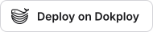

# Servers and containers

[The guide](README.md) · [Ponos](../README.md)

Ponos on a server, in Docker, or on Dokploy.

## On a server

The runner is at its best where it never sleeps. Nothing about it assumes a desktop, but
five things change when it moves off your laptop.

**Claude Code needs its own credentials there.** This is the real prerequisite, and it is
worth settling before anything else: a headless machine has no browser to log in with.
Authenticate once, or provide `ANTHROPIC_API_KEY` — which bills per token rather than
against a subscription, and changes the economics of a ten-second cadence considerably.

**`gh` has no keyring.** Password-store lookups fail silently in a systemd service and you
get pushed branches with no pull request. Put a token in the unit instead:

```ini
# ~/.config/systemd/user/ponos.service
Environment=GH_TOKEN=ghp_…
```

Scope it to the repositories the runner may touch, and nothing else.

**Paths differ from your laptop.** A project's `Path` property in Notion names one
machine's layout, and the server's is not the same. That is why a `[projects]` entry in
the local configuration wins over it: each machine overrides what it needs, and the board
keeps the mapping that suits the machine you use most.

**The session link must cross the network.** A session that ran on the server left its
transcript there, so a link opening a local terminal would find nothing. Set
`session_host` to the ssh destination and the Session cell keeps working from your laptop
— the click opens the conversation over ssh:

```toml
[runner]
session_host = "salva@vps.example.com"
```

A link is something anybody can paste into a cell, so the handler reads it as data and
nothing else: the destination must look like one — letters, digits and `. _ : @ [ ] -`,
never a leading dash — the session identifier must be letters, digits and dashes, and ssh
is given the destination after `--`. A link that does not fit is refused with the reason
rather than opened, which is what keeps `?host=-oProxyCommand=…` from being an option.

**Desktop notifications are pointless there.** They fail quietly, so nothing breaks, but
set `notify = false` to stop trying. This is where
[Telegram or Slack](channels.md#being-told-and-answering-with-one-word) stops being a convenience and
becomes the way you hear about anything at all: a server has no screen to draw on, and a
question nobody is told about waits until you next open the board.

And the thing to make sure of: **run one runner, not two.** Claiming a ticket is a read
then a write, not an atomic operation, so two runners watching the same board will
occasionally start the same ticket twice. If you keep a copy on your laptop, keep it
stopped (`ponos disable`) and use it for `--ticket` runs on demand.

### Who can write a ticket can run commands on that machine

This deserves saying plainly rather than burying it. The runner starts sessions in
`bypassPermissions`: the worktree protects your *repository*, not the machine. Anyone who
can move a ticket to the ready column can therefore have arbitrary commands run under the
account the runner uses.

On a personal laptop where you are the only author, that is the same trust you already
give Claude Code. On a server whose board is shared — a Notion workspace with partners, a
database someone else can edit — it is a different proposition. What makes it sound:

- a **dedicated account** on the server, holding the repositories and nothing else: no
  other project's secrets, no keys that reach beyond what the runner needs;
- a **narrowly scoped `GH_TOKEN`**, so the worst case stays inside the repositories the
  runner already writes to;
- **editing rights on the tickets database limited** to the people you would let run a
  command on that machine — which is the honest way to read that permission. Since the
  comments of a ticket reach the prompt too, and since answering a ticket the runner has
  already handled starts a run of its own, that includes **comment-only** collaborators:
  on a shared board, they are the same permission.

The same holds of the **messaging channels**, one step removed: an answer typed in
Telegram or Slack becomes a comment on the ticket, and a comment wakes it. With
`allowed_users` empty — the default, and the old behaviour — anybody who can write where
the runner reads can do that: only you in a private Telegram chat, but every member of a
Telegram group or of the Slack channel. On anything shared, fill in
`[notify.telegram] allowed_users` and `[notify.slack] allowed_users` with the ids of the
people you would let run a command on that machine; `ponos doctor` warns about a
channel that answers to anybody.

Setting `permission_mode = "acceptEdits"` narrows it further, at the cost of sessions that
stall the first time one needs to run the test suite. It is the right setting for a shared
board and the wrong one for a private machine.

The same sentence covers the web console, more directly: whoever can reach that port can
run commands on that machine. On a server, leave it on loopback and reach it through the
ssh tunnel above — never on `0.0.0.0` because it happened to be easier that evening. In a
container behind a domain, see [Docker](#docker): there it listens to the proxy, and the
installation code then the password are what stand between the Internet and the runner.

## Docker

The image is another way to install the runner, not another program: the same Python and
the same packages — httpx, pydantic, the console's FastAPI and uvicorn —, installed from
`requirements.txt` when it is built (a container has no per-version `.venv`), with what `install.sh` would have found on the machine — git,
`gh`, Node and Claude Code. The console is not built in it; it is committed, built.

```sh
docker compose up -d
docker compose logs ponos          # the address, and "code  XXXX-XXXX"
```

`docker-compose.yml` publishes no port, because on a server the proxy reaches it (see
Dokploy, below). To open it on your own machine, add `ports: ["127.0.0.1:8787:8787"]` to
the service, then open `http://127.0.0.1:8787` — the request comes from Docker's network
rather than from loopback, so the first connection asks for the code from the logs.

**One service, two halves.** The container runs the loop the systemd timer would have
started — `ponos run --every`, a run every `runner.interval_seconds`, each in a process
of its own that takes the run lock like any other, so two passes never overlap — and the
console in the foreground, whose logs are the container's. The loop reads the interval
again before every wait, and starts the next run at once when the configuration changes:
the minute a board is connected, its first run begins. Until there is one, it says so once
and waits. The image sets the interval to 60 seconds in the configuration it writes on
first start — and, when no `PONOS_NOTION_TOKEN` is given, the board in Markdown files
on the data volume, so there is one to write a ticket on at once; with `ANTHROPIC_API_KEY`
and no `CLAUDE_CODE_OAUTH_TOKEN`, the `api_key` provider. That file is written once: the
console changes it afterwards. `GET /healthz` answers `{"ok": true}` without a key, and is
the image's `HEALTHCHECK`.

**The volumes** are the four places that outlive a container:

| Volume | Mounted on | What it holds |
|---|---|---|
| `ponos-data` | `/data` | `XDG_CONFIG_HOME` and `XDG_STATE_HOME`: `config.toml`, the journal, the logs, the worktrees |
| `ponos-workspace` | `/workspace` | `workspace_root`: the projects, cloned there by Ponos when they are missing |
| `ponos-claude` | `/home/ponos/.claude` | Claude Code's sign-in and its sessions |
| `ponos-gh` | `/home/ponos/.config/gh` | `gh`'s sign-in, when it is not `GH_TOKEN` |

**The variables**, each optional, read from the environment or from a `.env` beside the
compose file. **This is where a container's secrets go** — Dokploy's *Environment* tab, below
— and never into a `config.toml` copied into the image or onto a volume: the runner does
not read a secret from that file anyway (see [Configuration](configuration.md#configuration)). A secret
typed in the console's first connection or Settings lands in `/data/config/ponos/secrets.env`,
`600`, on the `ponos-data` volume, and wins over the variable.

| Variable | What it does |
|---|---|
| `PONOS_WEB_EMAIL`, `PONOS_WEB_PASSWORD` | Both set: the console is claimed before anybody opens it, and the first connection starts after the account. |
| `PONOS_NOTION_TOKEN` | The Notion integration token. |
| `PONOS_TELEGRAM_TOKEN`, `PONOS_SLACK_TOKEN` | The bots that reach your phone. |
| `PONOS_WEB_TOKEN` | The console's token, for scripts; drawn and kept in the volume when empty. |
| `GH_TOKEN` | The account pull requests are opened as; `git` pushes through `gh` with it. |
| `ANTHROPIC_API_KEY` | The key of the `api_key` provider. |
| `OPENROUTER_API_KEY` | The OpenRouter key. |
| `CLAUDE_CODE_OAUTH_TOKEN` | The subscription without a terminal: the token `claude setup-token` prints, read by Claude Code itself. |
| `PONOS_LANGUAGE` | `en` or `fr`: `runner.language` when the file names none — the reports, and the console until somebody picks another. |

**Signing Claude Code in**, for the `cli` provider: `CLAUDE_CODE_OAUTH_TOKEN`, above, or
once from a terminal in the container, and the sign-in is kept in its volume.

```sh
docker compose exec ponos claude auth login
```

The first connection shows the command and checks the sign-in afterwards; `docker compose
exec ponos ponos doctor` says the same from a terminal. The runner runs as the `ponos`
user, not as root — Claude Code refuses `bypassPermissions` to root.

**Updating** is pulling a new image: `docker compose pull && docker compose up -d`. Inside a
container the runner never updates itself — there is no install directory to move and no
unit to restart — and the version in the console's header says so instead of offering a
button. A release publishes `ghcr.io/hermez-agency/ponos` with its version as the tag,
and `latest`.

**What you lose** in a container, against a machine:

- **Claude in Chrome**, unless the provider is the CLI *and* a Chrome is reachable from the
  container — which it is not by default: the image carries no browser;
- **desktop notifications** — there is no desktop. Telegram or Slack are the only ways to be
  told, which is why the first connection asks for them;
- **`ponos://` links** — a session cannot open in a terminal on your machine from there;
  `session_host` with an ssh destination is the way back to one.

## Install with Dokploy

<p>
  <a href="https://templates.dokploy.com/?q=ponos"><picture><source media="(prefers-color-scheme: dark)" srcset="../docs/media/dokploy/deploy-on-dokploy-dark.svg"></picture></a>
</p>

[Dokploy](https://dokploy.com) runs a compose file behind Traefik, with HTTPS and a domain,
and that is the whole of what the console needs. Ponos is in its template catalogue — the
[Ponos card](https://templates.dokploy.com/?q=ponos) —, from the files in
[`docker/dokploy/`](../docker/dokploy/). Three steps:

1. **Create it.** In your Dokploy, a project, then **Templates** › search *Ponos* ›
   **Create**. Dokploy draws a domain, a password and a token, and writes them in the
   service's *Environment* tab.
2. **Give it a way to reach Claude** — the only thing required — in that *Environment* tab:
   your subscription, with the token `claude setup-token` prints on any machine with a
   browser, in `CLAUDE_CODE_OAUTH_TOKEN`; or an Anthropic key in `ANTHROPIC_API_KEY`. The
   rest is optional, and can be added later the same way.
3. **Deploy, and open the domain** (*Domains* tab; turn HTTPS on). Sign in with
   `PONOS_WEB_EMAIL` and `PONOS_WEB_PASSWORD`, shown in the *Environment* tab. The console's
   *Summary* says what is still missing, and the step that fills it in.

Every variable, as `template.toml` gives it — each one carries the same comment there:

| Variable | Filled in by | What it does |
|---|---|---|
| `PONOS_WEB_EMAIL` | the template: `admin@<the domain>` | the console's sign-in — only a login, never written to; change it to yours if you like |
| `PONOS_WEB_PASSWORD` | the template: `${password:32}` | its password; the *Environment* tab shows it whenever you need it |
| `PONOS_WEB_TOKEN` | the template: `${password:48}` | what a script carries in `Authorization: Bearer` |
| `CLAUDE_CODE_OAUTH_TOKEN` | **you**, or the next one | your Claude subscription: `claude setup-token`, run once on a machine with a browser, prints it |
| `ANTHROPIC_API_KEY` | **you**, or the previous one | an Anthropic key, billed by the token; given without the token above, the provider is `api_key` from the first start |
| `OPENROUTER_API_KEY` | you, optional | an OpenRouter key, in every session's environment for the other models a ticket calls; the sessions run there only once *Settings › OpenRouter* says so — see [Every other model](configuration.md#every-other-model) |
| `GH_TOKEN` | you, optional | the account pull requests are opened as (`repo` scope, or fine-grained with Contents and Pull requests on read and write). Empty: create a GitHub App from the console instead, *Settings › GitHub › Connect GitHub* — see [Connect GitHub in one click](configuration.md#connect-github-in-one-click) |
| `PONOS_NOTION_TOKEN` | you, optional | a Notion integration; without one the board is Markdown files on the data volume |
| `PONOS_TELEGRAM_TOKEN` | you, optional | a bot from @BotFather; say anything to it, then `ponos notify --pair` in Dokploy's *Terminal* tab finds your chat |
| `PONOS_SLACK_TOKEN` | you, optional | a Slack bot (`xoxb-…`); the channel's ID goes in *Settings › Slack* |
| `PONOS_LANGUAGE` | the template: `en` | `en` or `fr` — the reports, and the console until you pick another |
| `TZ` | the template: `UTC` | the zone a schedule's hours are read in — `Europe/Paris`, say: 09:00 is then nine in Paris |

**Only Claude is required**, and one way to it is enough. With nothing else, the container
starts on a board of Markdown files and the console is the whole of the interface: sign in,
add a project, write a ticket. Everything not given yet is said in the console's *Summary*
— `missing`, and the step that fills it in — rather than by a container restarting in a loop;
the image answers its healthcheck on `/healthz` whatever is configured. A Notion token given
later goes in the *Environment* tab, then *Settings › Board kept in › notion*, then the
*Notion* step of `/setup`, which builds the board under the page you shared. A variable
changed in the *Environment* tab is read at the next **Deploy**.

What the template decides for you, and why:

- **the image is pinned** to a release, `ghcr.io/hermez-agency/ponos:<version>`, never
  `latest`, and `meta.json` says the same version: `scripts/release.py bump` moves both in the
  same commit as `__version__`, and `release.py check` and the tests refuse a tree where they
  lag. A new version is a new pin: change the tag in the *General* tab's compose, then
  **Deploy**;
- **the four volumes** of [Docker](#docker) — the configuration, the board and the
  journal on `ponos-data`, the clones and their worktrees on `ponos-workspace`, and the
  sign-ins of Claude Code and `gh` on `ponos-claude` and `ponos-gh` — so a restart, a
  redeploy or a new image keep everything;
- **the `ponos` user**, as in the image, never root: Claude Code refuses `bypassPermissions`
  to root;
- **a healthcheck** on `/healthz`, which needs no key, with a minute of grace for the first
  start;
- **a memory ceiling of 4 GB** (`deploy.resources.limits.memory`): a ceiling, not a
  reservation — enough for the two sessions `runner.max_concurrent` allows by default. Raise
  it in the compose with that number;
- **the domain** on port `8787` of the `ponos` service, the port the console listens on;
  turn HTTPS on and every cookie the console sets is `Secure`. `https://<the domain>/mcp`
  is then what you paste in Claude — see [Connect Ponos to Claude](console.md#connect-ponos-to-claude).

**When the catalogue is not there** — a Dokploy too old to have Ponos in it, or a template
newer than the catalogue's copy —, the same thing is one import away: a **Compose** service,
*Advanced › Import*, and the Base64 of the two files —

```sh
python3 -c 'import base64, json; print(base64.b64encode(json.dumps({"compose": open("docker/dokploy/docker-compose.yml").read(), "config": open("docker/dokploy/template.toml").read()}, indent=2).encode()).decode())'
```

— which is what the catalogue's own *Copy Base64* button produces. Then steps 2 and 3 above.

### From this repository instead

The template is the short road. The long one is the repository's own compose file, which
builds the image — for a fork, or a commit no release carries yet.

1. **Create a Compose service** from this repository (or from your fork), compose file
   `docker-compose.yml`. Dokploy builds the image; a release's `ghcr.io` image works too.
2. **Environment** tab: whichever of the variables above you want — at the least
   `GH_TOKEN`, and the provider's key unless you sign the CLI in. `PONOS_WEB_EMAIL` and
   `PONOS_WEB_PASSWORD` make the console yours before it is ever reachable. Every secret
   goes here — `PONOS_NOTION_TOKEN`, `PONOS_TELEGRAM_TOKEN`, `PONOS_SLACK_TOKEN` too —
   rather than into a file: Dokploy keeps them out of the repository and out of the image.
3. **Domains** tab: a domain on the service `ponos`, port `8787`, HTTPS on. Traefik
   terminates TLS and says so in `X-Forwarded-Proto`, and every cookie the console sets is
   then `Secure`. It also says who it relays in `X-Forwarded-For`, which the console only
   believes from a proxy it was told about: `PONOS_WEB_TRUSTED_PROXIES` in the
   **Environment** tab, Traefik's address on Dokploy's network (`docker inspect
   dokploy-traefik` on the server). Without it, a wrong password is counted against
   Traefik, and so against every visitor at once. `https://<the domain>/mcp` is then what you paste in Claude — see
   [Connect Ponos to Claude](console.md#connect-ponos-to-claude).
4. **Deploy**, then **Logs**: the line `code  XXXX-XXXX` is the installation code the first
   connection asks for — unless the console was claimed by the two variables.
5. Open the domain and go through the steps. For the `cli` provider, Dokploy's **Terminal**
   tab on the service is where `claude auth login` is typed.

The console behind a domain is reachable by the whole Internet, and behind it sits a
runner with `bypassPermissions`: the installation code is what keeps the first stranger
from claiming it, and the password is what keeps everybody out after you. Choose it
accordingly.
