# La vue d'un ticket — audit, directions, refonte

Novembre 2026. La vue d'un ticket dans la console, ouverte en fenêtre au-dessus
du tableau (`record-window.tsx`, `ticket-window.tsx`) ou en page complète
(`ticket-page.tsx`) : ce qui n'allait pas, les trois directions pesées, celle
qui a été retenue et implémentée.

> Ce dossier est dans `notes/` et non dans `docs/design/` comme le ticket le
> demandait : `docs/` est le site public (the-ponos.app), tout fichier posé là
> est servi, et un test de `tests/test_release.py` refuse un `.md` ou un dossier
> inconnu sous `docs/`.

Les captures sont prises sur la console de démo (`scripts/demo.py`) : un ticket
de code en cours avec sa session en direct, un ticket de code en revue avec sa
PR et une CI rouge, un ticket bloqué sur une question — bureau 1440 × 900 et
téléphone 390 × 844, en fenêtre et en page. `before/` est `main`, `after/` est
cette branche.

## 1. Audit

La question posée à chaque capture : quelqu'un qui ouvre ce ticket veut savoir
**où il en est** et **s'il a quelque chose à faire**. En combien de temps la vue
le dit-elle ?

### Gravité haute — on ne trouve pas ce qu'on est venu chercher

| # | Constat | Où |
|---|---------|----|
| H1 | **Le statut est le cinquième mot d'une bande de métadonnées**, au même poids que « created 3d ago », entre la priorité et la date. Rien dans la vue ne dit en premier où en est le ticket ; la couleur de la colonne, qui porte tout le tableau, se réduit à un point de 6 px. | fenêtre et page |
| H2 | **L'action principale est un onglet à trouver.** En revue, « Décider » est le cinquième onglet sur six, avec un pictogramme rose de 16 px ; le seul bouton de la vue est un « … ». En cours, « Pause » et « Abandonner » sont deux boutons jumeaux au bout de la ligne des onglets. | fenêtre et page |
| H3 | **Sur téléphone, les onglets n'arrivent qu'à 550 px de haut sur 844, et le cinquième est coupé au bord** (« Dec »). Avant eux : le retour, le titre sur deux lignes, l'identifiant, un lien « pull request », une ligne « Your decision is awaited » — un rattrapage propre au téléphone pour H2 —, la bande de faits sur quatre lignes, la CI. Les gestes du ticket passent sur une ligne à eux, sous les onglets. | page mobile |
| H4 | **La pull request est dite trois fois, sa CI deux fois** : « pull request ↗ » dans l'en-tête de la page, « PR #391 » dans la bande, « PR #391 » encore dans l'onglet Résultat avec « CI failed », déjà dépliée juste au-dessus. Trois liens vers la même adresse, et aucun des trois ne ressemble à l'endroit où la PR se lit. | page ; deux fois en fenêtre |

### Gravité moyenne — on trouve, mais on relit

| # | Constat | Où |
|---|---------|----|
| M1 | **La bande de faits n'a pas de noms.** « $8.13 opus worked 38 min 12 s last session 38 min » : sept valeurs à la suite, à deviner. Session et machine sont derrière un « … » de 12 px, sans nom non plus. | fenêtre et page |
| M2 | **Six onglets de natures différentes** : deux contenus (Résultat, Mission), une conversation, deux journaux (Direct, Journal), une action (Décider). « Direct » n'a rien de direct sur neuf tickets sur dix ; « Journal » et « Direct » racontent la même chose à deux échelles et se renvoient l'un à l'autre. | fenêtre et page |
| M3 | **Fenêtre et page ne disent pas la même chose dans leur en-tête.** La fenêtre : l'identifiant au-dessus du titre, et l'objectif. La page : l'identifiant dessous, pas d'objectif, mais deux liens (pull request, session) que la fenêtre n'a pas. | fenêtre contre page |
| M4 | **À l'ouverture de la fenêtre, le focus est sur le choix de l'objectif** : un anneau orange autour d'un réglage secondaire, qui passe pour l'élément principal de la fenêtre — et une flèche du clavier change l'objectif du ticket. | fenêtre |
| M5 | **La cause d'un blocage est en petit** : une puce « Question for you » de 11 px et une ligne grise de 12 px, sous la bande de faits. C'est pourtant la seule chose de la vue sur laquelle on peut agir. | fenêtre et page |
| M6 | **Sur une page de 1440 px, tout tient dans la moitié gauche** d'une colonne de 1088 px ; la moitié droite est vide, pendant que les faits s'entassent sur une ligne. | page bureau |

### Gravité basse — à l'occasion

| # | Constat | Où |
|---|---------|----|
| B1 | L'état « en direct » est dit trois fois (le point de l'onglet, « writing now · 7 steps », « writing now · thinking… ») mais jamais dans le statut : la bande dit « In progress », sans la phase. | en cours |
| B2 | La bande de faits n'a aucune sémantique (des `span` séparés par des « · ») : un lecteur d'écran lit une phrase sans verbes. La cible du « … » fait 12 px. | accessibilité |
| B3 | « Pause » et « Abandonner » ont le même poids, côte à côte, alors que l'un garde le travail et l'autre le perd. *Non traité ici* : les gestes d'un ticket en cours (`ticket-stop.tsx`) restent tels quels, voir « Ce qui reste ». | en cours |
| B4 | Rapidité d'ouverture : rien à redire depuis #b352df29 (page différée d'un rendu, `content-visibility`, animations à 200 ms). Rien n'y est touché. | fenêtre |

### Les captures d'avant

| | Fenêtre, bureau | Page, bureau | Page, téléphone |
|---|---|---|---|
| En revue |  |  | 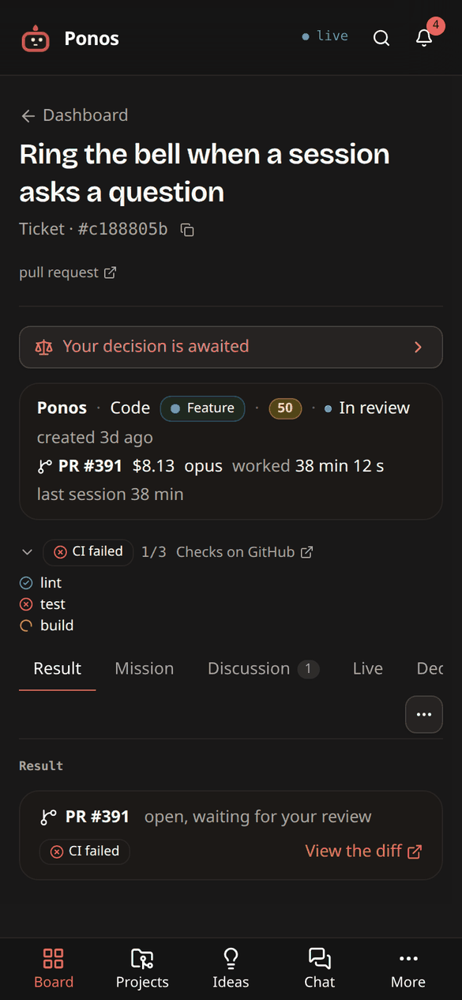 |
| En cours |  |  | 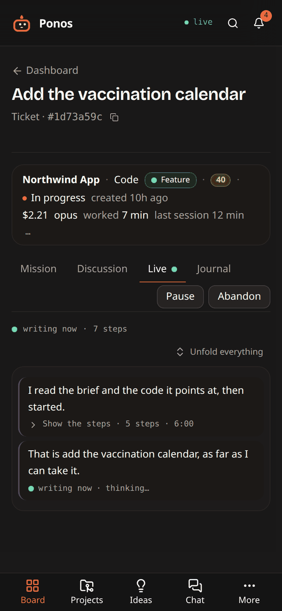 |
| Bloqué |  | 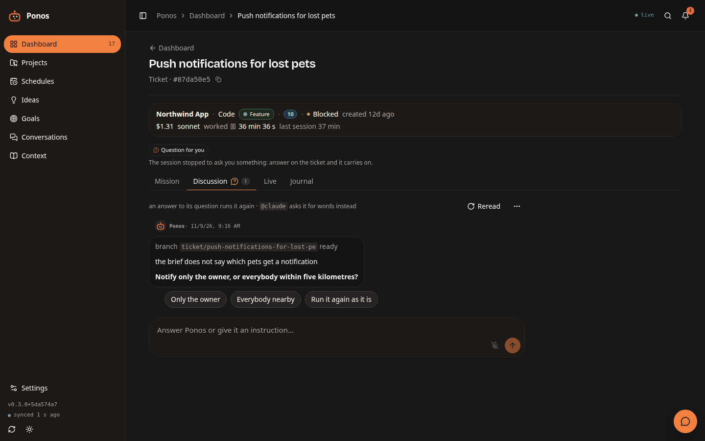 |  |

## 2. Trois directions

Dessinées en filaire dans VectorCraft (Claude Design n'était pas accessible
depuis la session) : `directions.svg` est la source, `directions.png` son
export.

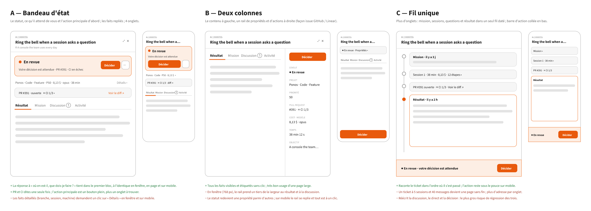

| | A — Bandeau d'état | B — Deux colonnes | C — Fil unique |
|---|---|---|---|
| L'idée | Le statut, ce qu'il attend et l'action principale d'abord ; les faits repliés ; moins d'onglets. | Le contenu à gauche, un rail de propriétés et d'actions à droite, comme une issue GitHub ou Linear. | Plus d'onglets : mission, sessions, questions et résultat dans un seul fil daté, l'action collée en bas. |
| Répond à | H1, H2, H3, H4, M2, M5 | M1, M6, H4 | H2, M2 |
| Pour | Même réponse en fenêtre, en page et sur téléphone. | Tous les faits visibles et nommés ; bon usage d'une page large. | Raconte le ticket dans l'ordre ; l'action sous le pouce. |
| Contre | Les faits rares demandent un clic en fenêtre. | En fenêtre (768 px) le rail prend un tiers au résultat ; le statut redevient une propriété parmi d'autres ; sur téléphone tout est replié. | Un ticket à cinq sessions devient une page sans fin ; plus d'adresse par onglet ; réécrit discussion, direct et décision. |

**Retenue : A, avec le rail de B là où il a la place.** Le bandeau d'état
répond aux quatre constats graves et se dessine pareil partout. Le rail de B ne
vaut que sur une page large — exactement là où A laisse la moitié de l'écran
vide (M6) : la liste des faits y devient une colonne à côté des onglets, et
reste une ligne avec « Détails » en fenêtre et sur téléphone. C'est une seule
liste, dessinée de deux façons selon la place (une media query lue par la page,
pas des règles de plus dans la feuille de style du premier chargement, tenue à
un budget). C est écartée : elle casse les
adresses par onglet et les parcours de la discussion et de la décision, pour un
gain que le bandeau apporte déjà.

## 3. La direction retenue, en détail

Trois blocs au-dessus des onglets, les mêmes en fenêtre et en page
(`frontend/src/components/console/ticket-status.tsx`) :

1. **Le statut** (`TicketStatus`) — la colonne en toutes lettres, dans sa
   couleur de tableau (fond et bord du bandeau) ; une phrase sur ce que le
   ticket attend (« Votre décision est attendue. », « Une session travaille
   dessus. » ou la phase du run, la cause d'un blocage avec son pictogramme et
   sa ligne d'aide) ; et les gestes du ticket, au même endroit — celui qu'il
   attend en bouton plein (Décider, Débloquer), les autres en contour ou
   derrière « … ».
2. **Les faits** (`TicketFacts`) — une liste de définitions : projet, type,
   priorité, coût, modèle, temps travaillé, puis dernière session, estimation,
   création, branche, session, machine. Repliée : une ligne des six premiers,
   sans noms, et « Détails ». Dépliée, ou d'office en colonne à droite sur une
   page d'au moins 1280 px : chaque fait sous son nom.
3. **La livraison** (`TicketDelivery`) — la pull request, une fois : son
   numéro, où elle en est, ses checks un par un, « Voir le diff ».

Puis les onglets, cinq au plus au lieu de six : **Décider** (en revue
seulement, en premier ; sur téléphone il ne se dessine qu'une fois ouvert, le
bouton du bandeau y mène), **Résultat**, **Mission**, **Discussion**,
**Activité** — la session et le journal réunis, la session d'abord quand elle
tourne, le journal d'abord sinon.

L'en-tête de la page porte l'objectif sous le titre, comme celui de la fenêtre ;
la fenêtre prend elle-même le focus à l'ouverture.

En français, et l'onglet Décider ouvert depuis le bouton du bandeau sur
téléphone (il n'y est dessiné qu'une fois ouvert ; Activité est alors à un
glissement de la liste) :

| Page en revue, en français | Fenêtre en revue, onglet Décider, téléphone |
|---|---|
|  |  |

### Fenêtre

| | Bureau | Téléphone |
|---|---|---|
| En cours |  |  |
| En revue, avec PR |  | 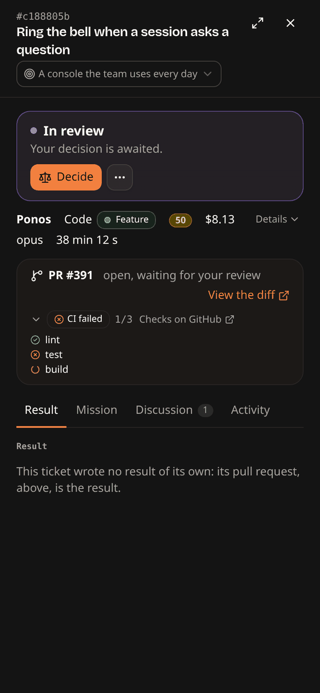 |
| Bloqué | 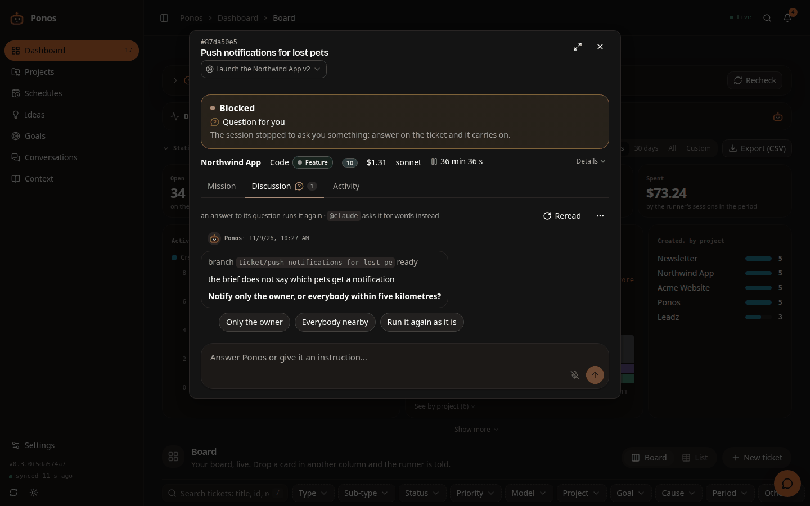 |  |

### Page

| | Bureau | Téléphone |
|---|---|---|
| En cours | 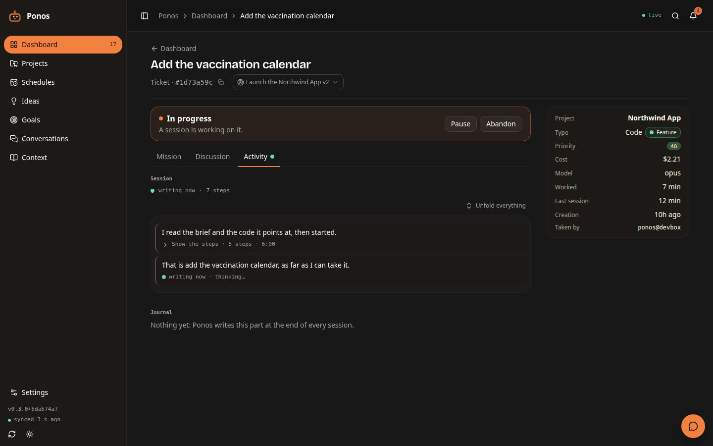 | 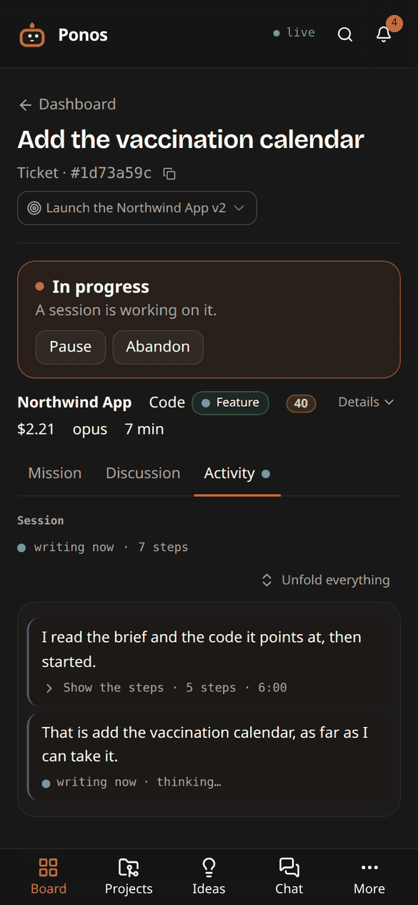 |
| En revue, avec PR | 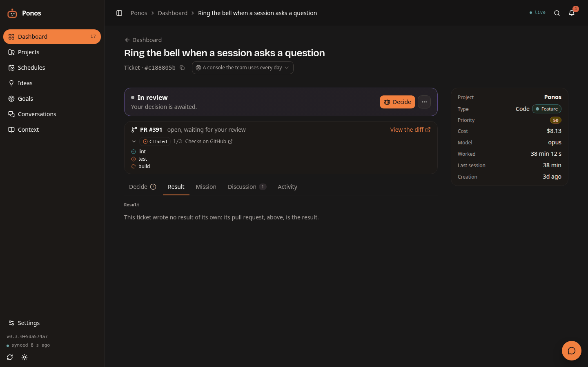 | 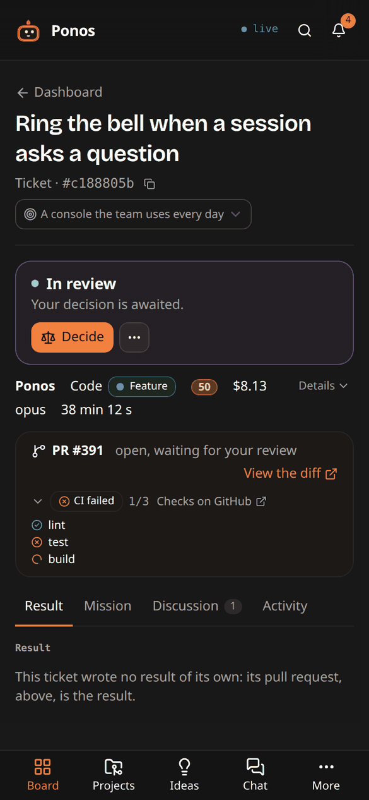 |
| Bloqué |  |  |

## 4. Ce qui change pour qui s'en sert

| Avant | Après |
|---|---|
| Statut : un point et un mot dans la bande | Bandeau en tête, dans la couleur de la colonne, avec ce que le ticket attend |
| Décider : un onglet, plus une ligne rose sur téléphone | Bouton plein dans le bandeau ; l'onglet en premier |
| Gestes au bout de la ligne des onglets | Dans le bandeau, à côté du statut |
| Cause du blocage : puce de 11 px sous la bande | Dans le bandeau, sous « Bloqué » |
| PR dans l'en-tête, la bande et le Résultat ; CI au-dessus des onglets et dans le Résultat | Un bloc, au-dessus des onglets |
| Faits sans noms ; « … » pour session et machine | Liste nommée ; « Détails », ou colonne sur page large |
| Onglets Direct et Journal | Un onglet Activité (`&tab=live` ; `&tab=journal` y mène) |
| Objectif en fenêtre seulement | En fenêtre et en page |

### Ce qui part, dit clairement

- La ligne « Your decision is awaited » propre au téléphone
  (`ticket-decide-cue`) : le bandeau dit la même chose partout.
- Les liens « pull request ↗ » et « session ↗ » de l'en-tête de la page : la PR
  a son bloc, le lien de session est dans les faits, à côté de l'identifiant de
  session.
- La carte de PR dans l'onglet Résultat : un ticket de code sans résultat écrit
  y dit « sa pull request, ci-dessus, est le résultat », suivi de ce que la
  session dit avoir changé.
- L'onglet Journal en tant qu'onglet, et son adresse `&tab=journal` (qui ouvre
  Activité).

Rien d'autre ne disparaît : résultat et versions, mission, validation, prompt
« On », discussion et réponses rapides, décision, session en direct, journal,
historique de qui a fait quoi, choix du projet d'un ticket bloqué, raison d'une
attente en *Ready*, note du passage précédent.

## 5. Ce qui reste

- **B3** — « Pause » et « Abandonner » de même poids sur un ticket en cours.
- Le bandeau n'est pas collant : sur une longue discussion, il sort de l'écran
  avec le reste. Un bandeau réduit qui reste en haut de la fenêtre se discute.
- Le pourcentage d'avancement d'un run (le plan de l'agent) est sur la carte et
  dans l'onglet Activité, pas dans le bandeau.

## 6. Direction B implémentée

Une autre branche (ticket « Console — Vue d'un ticket en deux colonnes »),
partie de celle de la direction A (PR #695) pour que les deux se comparent sur
les mêmes captures : même démo, mêmes trois tickets, mêmes tailles. Captures
dans `two-columns/`.

### Ce qui change par rapport à A

- **Deux colonnes, comme une issue.** À gauche, le titre et l'objectif (l'en-tête)
  puis les cinq onglets de A, inchangés. À droite, un **rail** de 17rem qui reste
  en vue pendant qu'on fait défiler les onglets (`position: sticky`, défilement
  propre s'il est plus haut que l'écran) : le bandeau d'état de A et son geste
  principal en premier, puis tous les faits chacun sous son nom, puis la pull
  request et ses checks.
- **Le statut reste en tête.** Le rail ne commence pas par une liste de
  propriétés : il commence par le bandeau, dans la couleur de la colonne, avec ce
  que le ticket attend et la cause d'un blocage (H1, M5 tiennent). Dans le DOM, le
  rail vient avant les onglets : un lecteur d'écran lit le statut d'abord.
- **Les réglages se modifient en place**, dans la liste des faits :
  priorité (un champ de 0 à 100), modèle de la prochaine session (ceux du board,
  ou celui du runner ; Fable seulement ainsi, choisi à la main — une nouvelle route
  `POST /api/tickets/<id>/model`, notée dans l'historique), projet d'un ticket qui
  n'a pas encore tourné (brouillon, prêt, bloqué — sauf l'arrêt « projet
  introuvable », dont le choix qui relance reste dans le bandeau), et *Force
  validated*, qui quitte l'onglet Mission pour une ligne du rail. L'objectif se
  change sous le titre, là où il est dit, pour ne pas le dire deux fois.
- **La fenêtre s'élargit plutôt que de céder un tiers.** La critique de
  l'audit — « en fenêtre 768 px, le rail prend un tiers au résultat » — est
  réelle : forcé dans la fenêtre de 48rem, le rail laisse 26rem aux onglets et
  coupe « Activité » au bord (`rejected-rail-in-a-48rem-window.png`). Trois
  réponses pesées : un rail étroit (moins de 14rem ne tient ni le bandeau avec
  ses deux boutons ni la liste des checks), un rail repliable (un clic de plus
  pour le statut, exactement ce que H1 reprochait), **une fenêtre plus large
  quand l'écran le permet** — retenue. Dès 64rem d'écran (1024 px), la fenêtre
  fait 64rem et les onglets gardent ~44rem, à peu près ce qu'ils avaient dans
  la fenêtre de A (`review-window-laptop.png`). En dessous, la fenêtre reste à
  48rem et passe en une colonne, celle de A (`review-window-tablet.png`). La
  page a la barre latérale à côté d'elle : le rail y vient à 80rem.
- **Téléphone : une seule colonne**, celle de A — le statut et l'action en
  haut, les faits sur une ligne et « Détails », la PR, les onglets ; Décider
  n'est jamais coupé (H3). « Détails » déplie aussi les réglages
  (`review-page-mobile-details.png`).
- **Fenêtre et page disent la même chose (M3)** : un seul arbre, deux
  dispositions décidées par une media query lue en JavaScript (`ticket-rail.ts`),
  comme A — pas de règle ajoutée à la feuille de style du premier chargement,
  tenue à un budget. La largeur de la fenêtre est un style en ligne pour la même
  raison. Le travail de #b352df29 (page différée d'un rendu, animations) n'est pas
  touché.

### Mieux et moins bien que A, constat par constat

| # | A — bandeau d'état | B — deux colonnes |
|---|---|---|
| H1 statut | En tête, toute la largeur. | En tête du rail, même bandeau ; un peu moins large, mais en vue tout le temps : il ne sort plus de l'écran sur une longue discussion (ce que A laissait dans « Ce qui reste »). **Mieux.** |
| H2 action | Bouton plein dans le bandeau. | Le même, et toujours visible. **Égal, un peu mieux.** |
| H3 téléphone | Onglets à ~430 px, Décider jamais coupé. | Identique. **Égal.** |
| H4 PR une fois | Un bloc au-dessus des onglets. | Un bloc dans le rail. Plus loin du résultat qui y renvoie, mais toujours visible ; il ne pousse plus les onglets vers le bas. **Mieux** pour lire le résultat, **moins bien** pour les checks d'une PR longue (rail plus étroit, liste plus haute). |
| M1 faits nommés | Une ligne sans noms et « Détails » en fenêtre ; noms sur page large. | Chaque fait sous son nom, sans clic, en fenêtre comme en page dès 1024 px. **Mieux.** |
| M2 onglets | Cinq. | Les mêmes cinq. **Égal.** |
| M3 fenêtre / page | Même vue, mais la colonne de faits sur page large seulement. | Même disposition en fenêtre et en page. **Mieux.** |
| M5 cause d'un blocage | Dans le bandeau. | Dans le bandeau du rail, en lignes plus courtes : un texte d'aide long y prend 4–5 lignes au lieu de 2. **Un peu moins bien.** |
| M6 page large à moitié vide | Comblé par la colonne de faits. | Comblé par le rail entier ; les onglets gardent toute la largeur restante. **Mieux.** |
| Réglages | Priorité et modèle ne se changent pas depuis la vue ; *Force validated* au bas de Mission. | Tous en place, dans le rail. **Mieux** (et une route de plus côté serveur). |
| Fenêtre | 48rem. | 64rem dès 1024 px d'écran : la fenêtre couvre presque tout le tableau, qu'on voit moins en dessous. **Moins bien** pour qui ouvre un ticket pour jeter un œil et revenir au tableau. |
| Densité | Tout tient au-dessus du pli. | Le rail d'un ticket en revue avec PR dépasse 900 px de haut et défile en lui-même (`review-window-laptop.png`). **Moins bien.** |
| Entre 768 et 1024 px | Une colonne. | Une colonne aussi : B n'y apporte rien. **Égal.** |

En bref : B gagne sur ce qu'on lit souvent sans agir (les faits, la PR, le
statut toujours en vue) et sur les réglages ; A reste plus compact, garde la
fenêtre légère au-dessus du tableau, et lit mieux la cause d'un blocage.

### Côte à côte

| | |
|---|---|
| Fenêtre en revue | 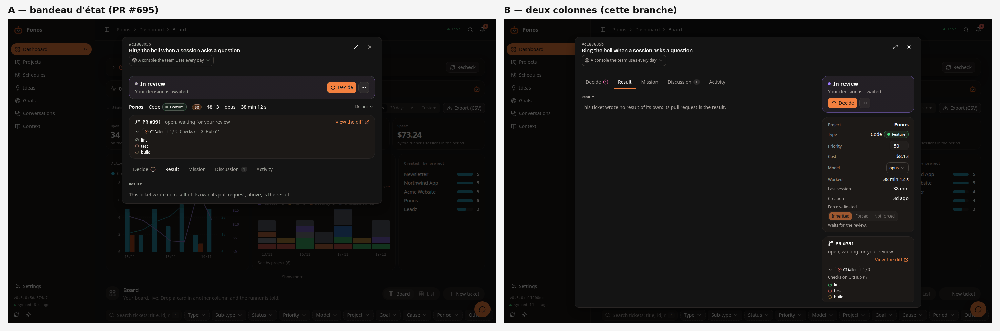 |
| Page en revue | 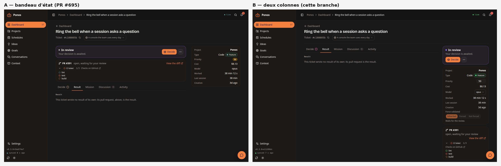 |
| Fenêtre bloquée | 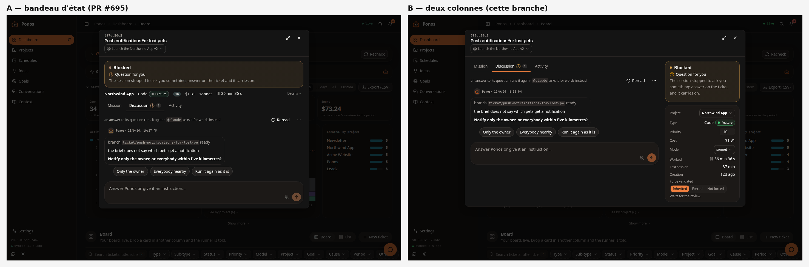 |

### Fenêtre

| | Bureau | Téléphone |
|---|---|---|
| En cours | 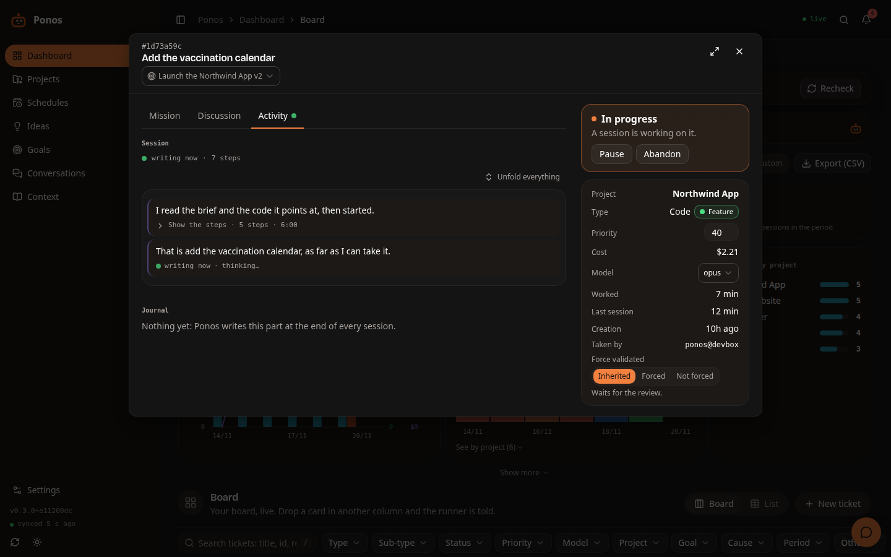 | 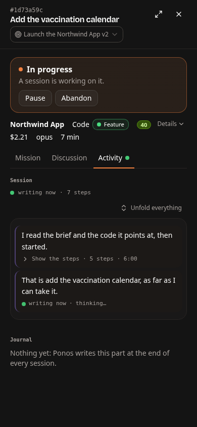 |
| En revue, avec PR | 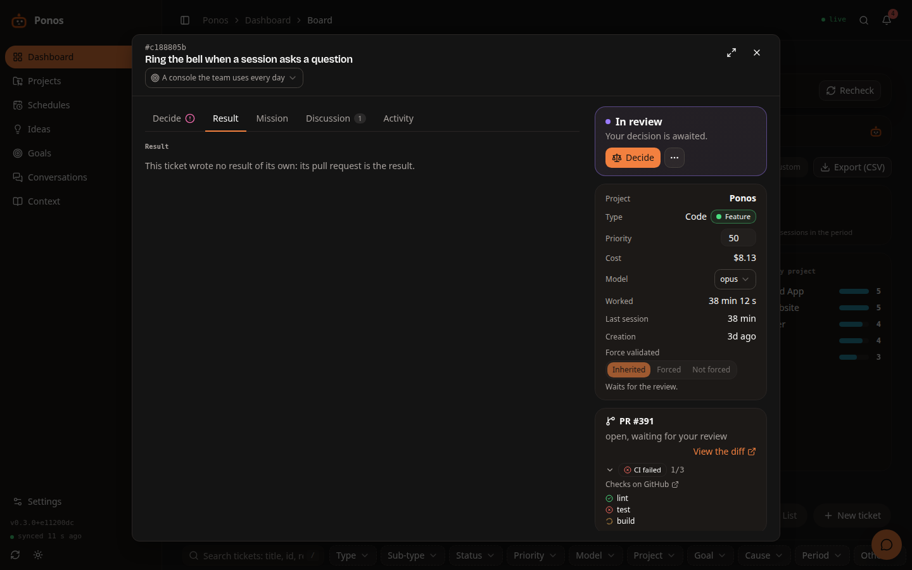 | 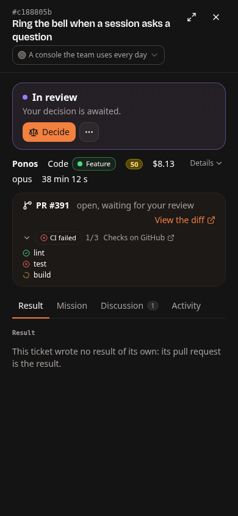 |
| Bloqué | 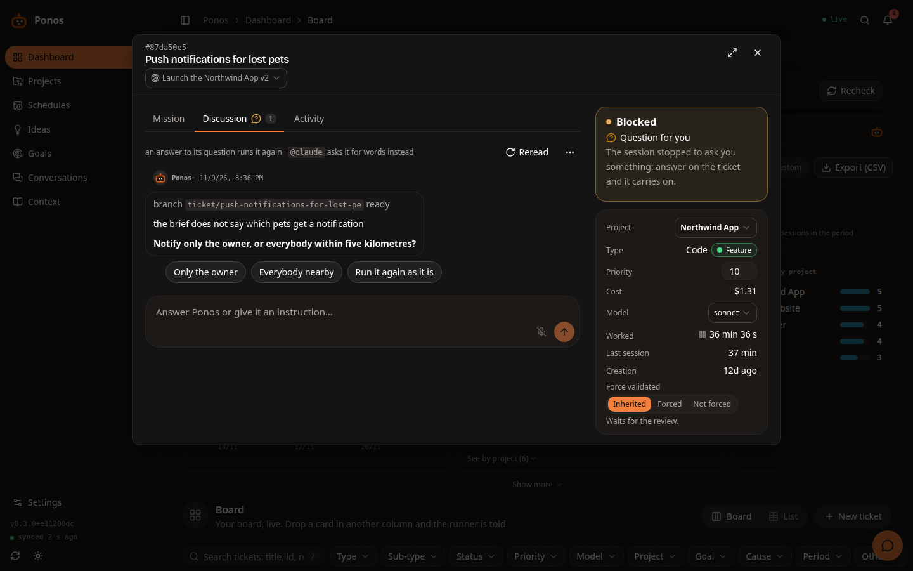 | 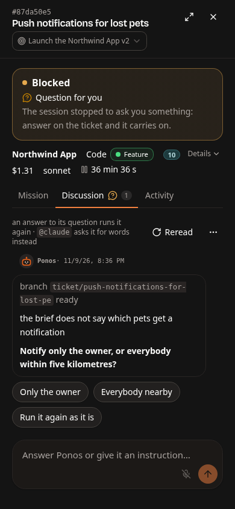 |

### Page

| | Bureau | Téléphone |
|---|---|---|
| En cours | 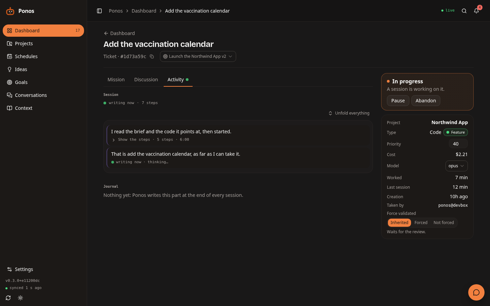 | 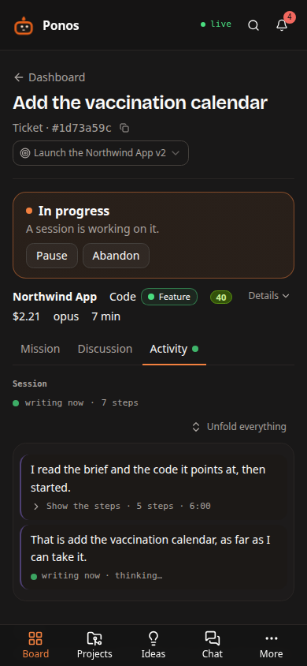 |
| En revue, avec PR | 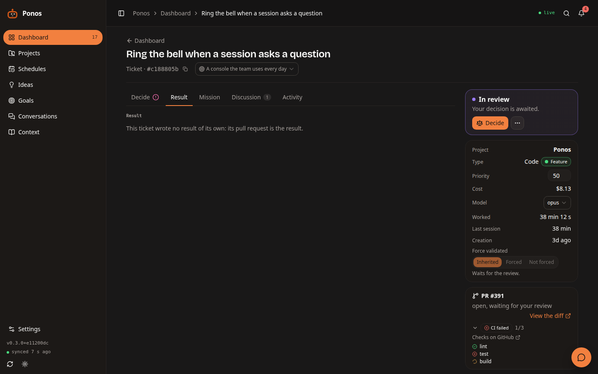 | 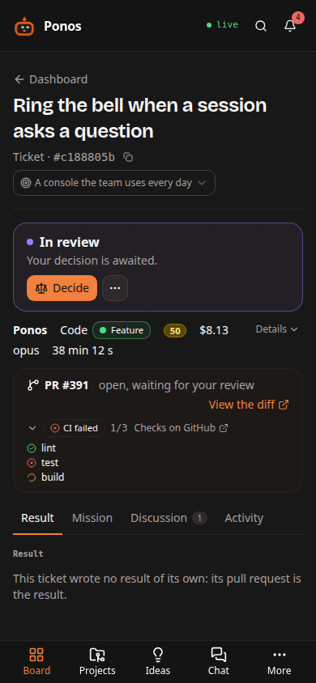 |
| Bloqué | 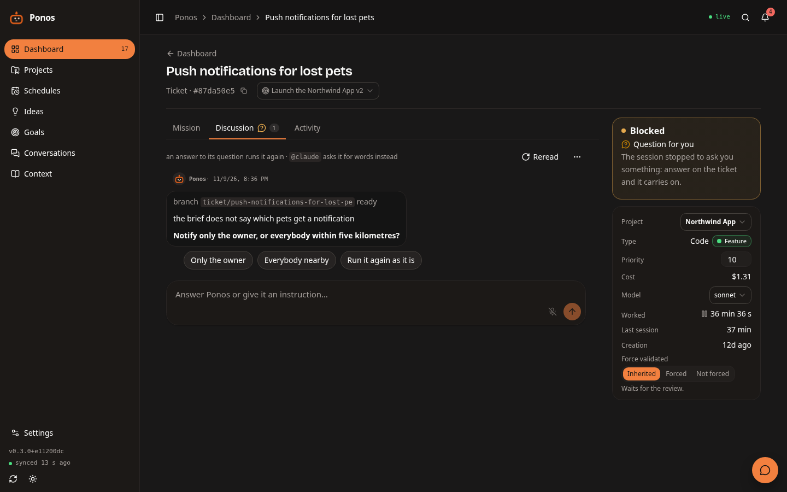 | 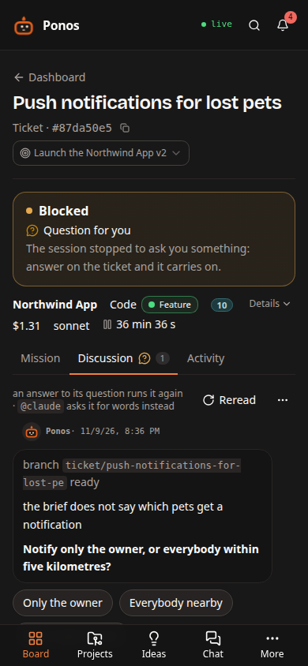 |

### La largeur de la fenêtre

| Écran de 1100 px : fenêtre de 64rem, rail | Écran de 900 px : fenêtre de 48rem, une colonne | Écarté : le rail dans la fenêtre de 48rem |
|---|---|---|
| 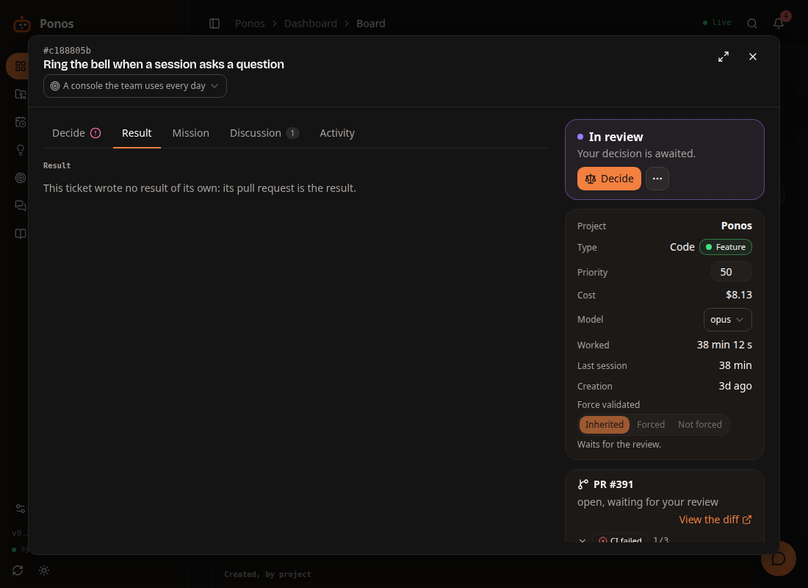 | 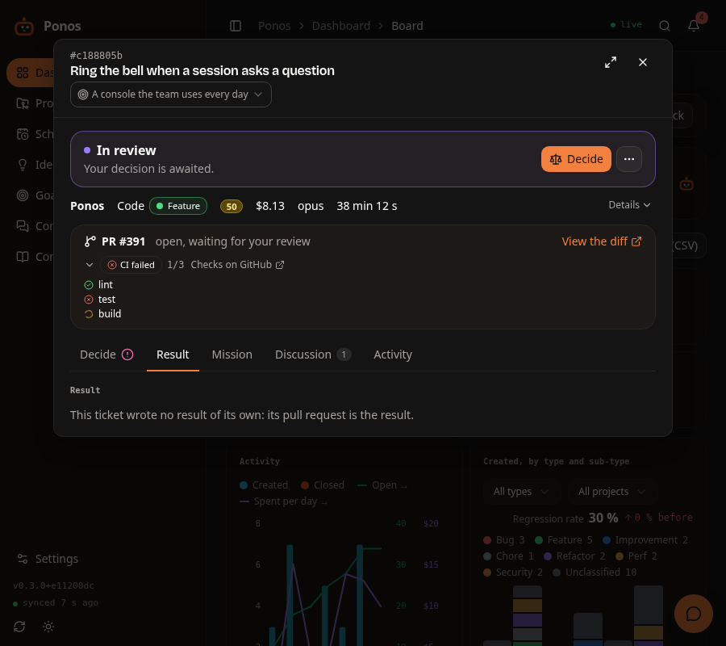 | 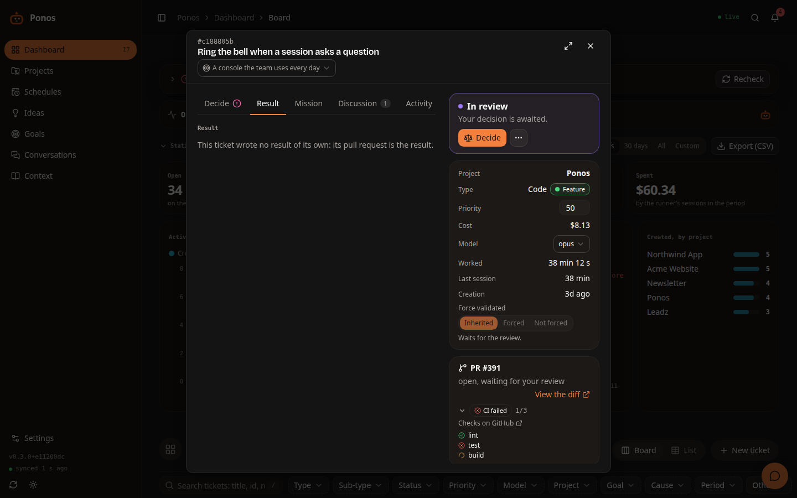 |
